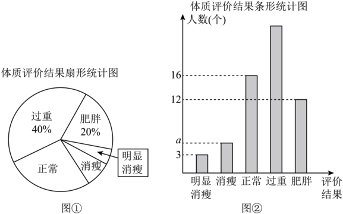

# Mathematics - 题目 76

**ID**: 580e02409ac346a4bb9e234d1ddd9032
**年级**: Grade 9
**难度**: Medium
**题型**: Calculation

## 题目
我国男性的体质系数计算公式是： $m=\frac {W}{H-105}\times 100\%$ ，其中W表示体重（单位：kg），H表示身高（单位：cm）．通过计算出的体质系数m对体质进行评价．具体评价如下表：$m$$<80\%$$80\%\sim 90\%$$90\%\sim 110\%$$110\%\sim 120\%$$>120\%$评价结果明显消瘦消瘦正常过重肥胖(1)某男生的身高是175cm，体重是80kg，他的体质评价结果是．(2)现从某校九年级学生中随机抽取n名男生进行体质评价，评价结果统计如下：①抽查的学生数n=；​​​​​​​‌；图②中a的值为．②图①中，体质评价结果为“正常”的扇形圆心角为°．(3)若该校九年级共有男生450人，试估计该校九年级体质评价结果为“过重”或“肥胖”男生人数的和．

## 解答

1. （1）∵某男生的身高是175cm,体重是80kg,
2. ∴ $m=\frac {80}{175-105}\times 100\%\approx 114\%$ m，
3. ∴他的体质评价结果是过重．
4. 故此题答案为：过重；
5. （2）①抽查的学生数 $n=12\div 20{\rm{\%}}=60$ ，
6. 过重的人数为 $60\times 40\%=24$ ，
7. $a=60-(3+16+24+12)=5$ ；
8. 故此题答案为：60，5；
9. ②图1中，体质评价结果为“正常”的所在扇形圆心角为 $360{}^\circ \times \frac {16}{60}=96{}^\circ $ ，
10. 故此题答案为：96．
11. （3） $450\times (40\%+20\%)=270$ （名）
12. ∴该校九年级体质评价结果为“过重”或“肥胖”的男生人数约270名．

## 知识点

**中文**:
  - 扇形统计图
  - 用样本估计总体
  - 条形统计图

**English**:
  - Pie Charts
  - Estimating Population from Sample
  - Bar Charts

---
