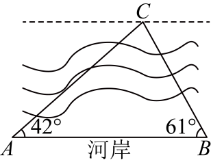

# Mathematics - 题目 1016

**ID**: 59f8cbdeb64241f58b081bd45ada61fb
**年级**: Grade 9
**难度**: Medium
**题型**: Calculation

## 题目
小明和小军两位同学对某河流的宽度进行测量，如图所示，两人分别站在同侧河岸上的点 $A$ ， $B$ 处，选取河对岸的一块石头 $C$ 作为测量点（点 $A，B，C$ 在同一水平面内），小明同学在点 $A$ 处测得 $∠BAC$ 为 $42{}\degree $ ，小军同学在点 $B$ 处测得 $∠ABC$ 为 $61{}\degree $ ，两人之间的距离 $AB$ 为60米，求此河流的宽度．（参考数据 ${\rm{s}}{\rm{i}}{\rm{n}}42{}\degree \approx 0.​​​​​​​‌67，{\rm{t}}{\rm{a}}{\rm{n}}42{}\degree \approx 0.90，{\rm{s}}{\rm{i}}{\rm{n}}61{}\degree \approx 0.87，{\rm{t}}{\rm{a}}{\rm{n}}61{}\degree \approx 1.80$ ）

## 解答

1. 解：过点 $C$ 作 $CD\bot AB$ 于点 $D$ ，
2. 
3. 设 $AD=x$ ，则由题意得 $BD=60-x$ ，
4. ∵在 ${\rm{R}}{\rm{t}}\vartriangle ADC$ 中， $\angle BAC=42{}\degree $ ， ${\tan}A=\frac {CD}{AD}$ ，
5. ∴ $CD={\tan}A\cdot AD=0.9x$ ，
6. ∵在 ${\rm{R}}{\rm{t}}△CDB$ 中， $\angle ABC=61{}\degree $ ， ${\tan}B=\frac {CD}{BD}$ ，
7. ∴ $1.8=\frac {0.9x}{60-x}$ ，
8. 解得 $x=40$ ，
9. ∴ $CD=0.9\times 40=36$ （米），
10. 答：此河流的宽度为 $36$ 米．

## 知识点

**中文**:
  - 解直角三角形的实际应用

**English**:
  - Applications of Solving Right Triangles

---
