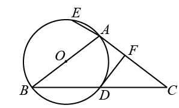

# Mathematics - 题目 2419

**ID**: 5d17710e6fa84a2597cdbfdc2f1469bb
**年级**: Grade 9
**难度**: Medium
**题型**: Calculation

## 题目
如图，在 $\vartriangle ABC$ 中，以 $AB$ 为直径的 $\odot O$ 交 $BC$ 于点D，与 $CA$ 的延长线交于点 ${\rm \mathit{E}，}\odot O$ 的切线 $DF$ 与 $AC$ 垂直，垂足为点F．(1)求证： $AB=AC$ ；​​​​​​​‌(2)若 $AC=6$ ， $\mathrm{∠}BAE=60{}\degree $ ，求 $\overset{\frown}{{AD}}$ 的长．

## 解答

1. （1）证明：如图，连接 $OD$ ，
2. 
3. ∵ $DF$ 是 $\odot O$ 的切线，
4. ∴ $OD\bot DF$ ，
5. ∵ $DF⊥AC$ ，
6. ∴ $OD\mathrm{/\mskip-4mu/}AC$ ，
7. ∴ $\angle ODB=\angle ACB$ ，
8. ∵ $OB=OD$ ，
9. ∴ $\angle ODB=\angle OBD$ ，
10. ∴ $\angle OBD=\angle ACB$ ，
11. ∴ $AB=AC$ ；
12. （2）∵ $OD\mathrm{/\mskip-4mu/}AC$ ， $\mathrm{∠}BAE=60{}\degree $ ，
13. ∴ $\angle AOD=\angle BAE=60{}\degree $ ，
14. ∵ $AB=AC=6$ ，
15. ∴ $OA=3$ ，
16. ∴ $l{{}_{{\mathop {AD}\limits_{}^{�}}}}=\frac {60{}\degree \times {\rm{π}}\times 3}{180{}\degree }={\rm{π}}$ ．

## 知识点

**中文**:
  - 切线的性质定理
  - 弧长公式

**English**:
  - Tangent Properties Theorem
  - Arc Length Formula

---
