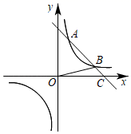

# Mathematics - 题目 3804

**ID**: 620356941d6b4f89817d6a8bb27326bd
**年级**: Grade 9
**难度**: Medium
**题型**: Calculation

## 题目
如图，在平面直角坐标系xOy中，一次函数y＝﹣x+b的图象与反比例函数 $y=\frac {k}{x}$ （k＞0）的图象相交于A，B两点，与x轴相交于点C(4，0)，且点B(3，n)，连接OB．（1）求一次函数和反比例函数的表达式；​​​​​​​‌（2）求△BOC的面积；（3）将直线AB向下平移，若平移后的直线与反比例函数的图象只有一个交点，试说明直线AB向下平移了几个单位长度．

## 解答

1. （1）将点C的坐标代入一次函数表达式y＝﹣x+b并解得：b＝4，
2. 故一次函数的表达式为：y＝﹣x+4，
3. 将点B的坐标代入y＝﹣x+4得：n＝﹣3+4＝1，故点B（3，1），
4. 将点B的坐标代入反比例函数表达式并解得：k＝3，
5. 故反比例函数表达式为：y＝ $\frac {3}{x}$ ；
6. （2）过点B作BD⊥x轴于点D，则BD=1，又OC=4，
7. 
8. 则△BOC的面积＝ $\frac {1}{2}$ OC×BD＝ $\frac {1}{2}$ ×4×1＝2；
9. （3）将直线AB向下平移m个单位（m＞0）得到直线的表达式为：y＝﹣x+4+m，
10. ∵直线AB向下平移m个单位后和反比例函数只有一个公共点，则 $\frac {3}{x}$ ＝﹣x+4﹣m，整理得：x^{2}+（m﹣4）x+3＝0，
11. ∴△＝b^{2}﹣4ac＝（m﹣4）^{2}﹣4×1×3＝0，解得：m＝4±2 $\sqrt {3}$ ，
12. 故直线AB向下平移了4+2 $\sqrt {3}$ 或4﹣2 $\sqrt {3}$ 个长度单位．

## 知识点

**中文**:
  - 一元二次方程根的判别式
  - 反比例函数综合
  - 坐标与图形变化——平移
  - 待定系数法求一次函数解析式
  - 几何问题

**English**:
  - Discriminant of Quadratic Equations
  - Comprehensive Inverse Proportionality Problems
  - Coordinates and Translation
  - Finding Expressions by Undetermined Coefficients
  - Geometry Problems

---
