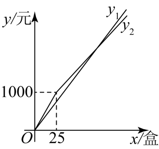

# Mathematics - 题目 3751

**ID**: 6a73f7a819704108b1687526c54110a0
**年级**: Grade 9
**难度**: Medium
**题型**: Calculation

## 题目
端午节吃粽子是中华民族的传统习俗．市场上豆沙粽礼盒的进价比肉粽礼盒的进价每盒便宜10元，某商家用2500元购进的肉粽和用2000元购进的豆沙粽盒数相同．(1)求每盒肉粽和每盒豆沙粽的进价；​​​​​​​‌(2)商家计划只购买豆沙粽礼盒销售，经调查了解到有A，B两个厂家可供选择，两个厂家针对价格相同的豆沙粽礼盒给出了不同的优惠方案：A厂家：一律打8折出售．B厂家：若一次性购买礼盒数量超过25盒，超过的部分打7折．该商家计划购买豆沙粽礼盒 $x$ 盒，设去A厂家购买应付 $y{{}_{1}}$ 元，去B厂家购买应付 $y{{}_{2}}$ 元，其函数图象如图所示：①分别求出 $y{{}_{1}}$ ， $y{{}_{2}}$ 与 $x$ 之间的函数关系；②若该商家只在一个厂家购买，怎样买划算？

## 解答

1. （1）解：设每盒豆沙粽的进价为 $a$ 元，则每盒肉粽的进价为 $\left ({a+10}\right )$ 元,
2. $\frac {2000}{a}=\frac {2500}{a+10}$ ,
3. 方程两边乘 $a\left ({a+10}\right )$ ，得 $2000\left ({a+10}\right )=2500a$ ,
4. 解得 $a=40$ ,
5. 检验：当 $a=40$ 时， $a\left ({a+10}\right )\ne 0$ ,
6. ∴ $a=40$ 是原方程的解,
7. $a+10=50$ ,
8. 答：每盒肉粽和每盒豆沙粽的进价分别为50元和40元．
9. （2）解：① $y{{}_{1}}=40\times 80\%x=32x$ （ $x\geqslant 0$ 且 $x$ 为整数）,
10. 当 $0\leqslant x\leqslant 25$ 且 $x$ 为整数时， $y{{}_{2}}=40x$ ,
11. 当 $x>25$ 且 $x$ 为整数时， $y{{}_{2}}=1000+\left ({40x-1000}\right )\times 70\%=28x+300$ ,
12. ∴ $y{{}_{2}}=\begin{cases}40x\left ({0\leqslant x\leqslant 25且x为整数}\right )\\32x+300\left ({x>25且x为整数}\right )\end{cases}$ ,
13. ②当 $x>25$ 且 $x$ 为整数，
14. $y{{}_{1}}=y{{}_{2}}$ 时 $32x=28x+300$ ,
15. $x=75$ ,
16. 由图象可知：购买粽子礼盒少于75盒，去A厂家购买划算；购买粽子礼盒等于75盒，去A厂家或B厂家购买一样划算；购买粽子礼盒多于75盒，去B厂家购买划算．

## 知识点

**中文**:
  - 分式方程的实际应用
  - 列一次函数解析式
  - 分配方案问题

**English**:
  - Applications of Fractional Equations
  - Writing Linear Function Expressions
  - Allocation Plan Problems

---
