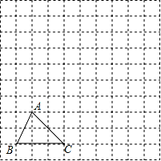

# Mathematics - 题目 607

**ID**: 70103f1f81d142f5a91823a8078edc49
**年级**: Grade 9
**难度**: Medium
**题型**: Calculation

## 题目
如图，在边长为1个单位长度的小正方形组成的网格中，给出了格点三角形ABC（顶点是网格线的交点）．（1）先将 ${\rm △\mathit{ABC}}$ 竖直向上平移6个单位，再水平向右平移3个单位得到 ${\rm △\mathit{A}_{1}\mathit{B}_{1}\mathit{C}_{1}}$ ，请画出 ${\rm △\mathit{A}_{1}\mathit{B}_{1}\mathit{C}_{1}}$ ；​​​​​​​‌（2）将 ${\rm △\mathit{A}_{1}\mathit{B}_{1}\mathit{C}_{1}}$ 绕B_{1}点顺时针旋转90°，得 ${\rm △\mathit{A}_{2}\mathit{B}_{1}\mathit{C}_{2}}$ ，请画出 ${\rm △\mathit{A}_{2}\mathit{B}_{1}\mathit{C}_{2}}$ ；（3）线段B_{1}C_{1}变换到B_{1}C_{2}的过程中扫过区域的面积为．

## 解答

1. (1) 如图所示；
2. (2) 如图所示；
3. 
4. （3）∵BC=3，
5. ∴线段B_{1}C_{1}变换到B_{1}C_{2}的过程中扫过区域的面积为 $\frac {90\mathrm{π}\times 3{^{2}}}{360}=\frac {9}{4}\mathrm{π}$ .

## 知识点

**中文**:
  - 平移的性质
  - 扇形面积的计算
  - 画旋转图形

**English**:
  - Properties of Translation
  - Sector Area Calculation
  - Drawing Rotated Figures

---
