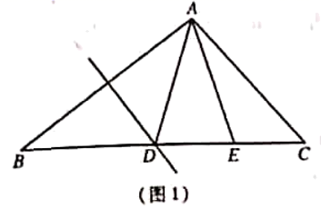
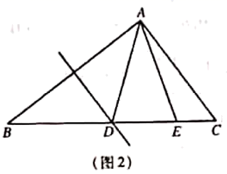

# Mathematics - 题目 3592

**ID**: 71195c49a4634c66a4a5f8e900805e72
**年级**: Grade 9
**难度**: Medium
**题型**: Calculation

## 题目
已知:在 $ΔABC$ 中, $AC<AB<BC$ ,线段 $AB$ 的垂直平分线交 $BC$ 于点 $D$ ,点 $E$ 在 $BC$ 上，且 $BE=AB$ ,连接 $AD,AE,\angle AEC=3\angle BAD.​​​​​​​‌$$\left ({1}\right )$ 如图1 ,求证: $AD=AE;$$\left ({2}\right )$ 如图2,当 $\angle B=2\angle CAE$ 时.在不添加任何辅助线情况下,请直接写出图2中的四个等腰三角形．

## 解答

1. $\left ({1}\right )$ 证明：令 $\angle B=α$ ，
2. $\because $ 线段 $AB$ 的垂直平分线交 $BC$ 于点 $D$ ，
3. $\therefore AD=BD$ ，
4. $\therefore \angle BAD=\angle B=α$ ，
5. $\therefore \angle ADE=\angle B+\angle BAD=2α$ ， $\angle AEC=3\angle BAD=3α$ ，
6. $\therefore \angle BAE=\angle AEC-\angle B=3α-α=2α$ ，
7. $\because AB=BE$ ，
8. $\therefore \angle AEB=\angle BAE=2α=\angle ADE$ ，
9. $\therefore AD=AE$ ；
10. 
11. $\left ({2}\right )$ 如图2，
12. ∵AB的垂直平分线交BC于D，
13. ∴AD=BD，
14. ∴ $ΔABD$ 是等腰三角形；
15. ∵AB=BE，
16. ∴△ABE是等腰三角形；
17. 由（1）知 $\angle AEB=\angle BAE=2α=\angle ADE$ ，
18. ∴△ADE是等腰三角形；
19. ∵ $\angle BAE=2α$ ， $\angle BAD=α$  ，
20. ∴ $\angle DAE=α$
21. ∵ $\angle B=2\angle CAE$ ，
22. ∴ $\angle CAE=\frac {1}{2}α$ ，
23. ∴ $\angle DAC=\frac {3}{2}α$ ， $\angle C=\angle AEB-\angle CAE=\frac {3}{2}α$  ，
24. ∴∠DAC=∠C，
25. ∴AD=CD，
26. ∴△ACD是等腰三角形；
27. ∴图中的等腰三角形是： $ΔABD$ ， $\Delta ABE$ ， $\Delta ADE$ ， $ΔACD$ .
28. 

## 知识点

**中文**:
  - 等腰三角形的判定与性质
  - 线段垂直平分线的性质

**English**:
  - Determination and Properties
  - Properties of Perpendicular Bisectors

---
