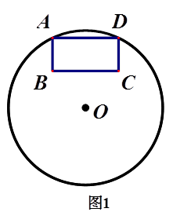
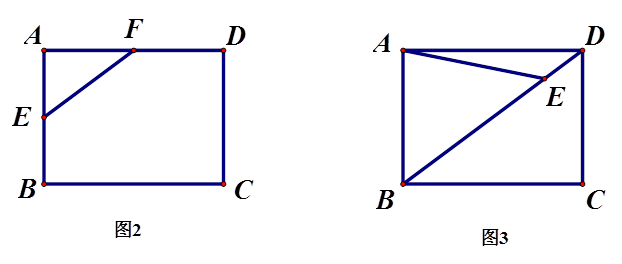

# Mathematics - 题目 1666

**ID**: 7140026c2622452ca416cb8020198f2f
**年级**: Grade 9
**难度**: Medium
**题型**: Calculation

## 题目
按要求作图，不要求写作法，但要保留作图痕迹．（1）如图1，矩形ABCD的顶点A、D在圆上,B、C两点在圆内，已知圆心O，请仅用无刻度的直尺作图，请作出直线l⊥AD；​​​​​​​‌（2）请仅用无刻度的直尺在下列图2和图3中按要求作图．（补上所作图形顶点字母）①图2是矩形ABCD，E，F分别是AB和AD的中点，以EF为边作一个菱形；②图3是矩形ABCD，E是对角线BD上任意一点（BE＞DE），以AE为边作一个平行四边形．

## 解答

1. （1）如图1所示：直线l即为所求的直线；
2. 
3. （2）如图2所示：四边形EFGH即为所求的菱形
4. 
5. （3）如图3所示：四边形AECF即为所求的平行四边形．
6. 

## 知识点

**中文**:
  - 尺规作图——作垂线
  - 菱形的判定
  - 矩形的性质
  - 正方形的性质
  - 线段垂直平分线的性质

**English**:
  - Construction: Perpendicular Line
  - Determination of Rhombuses
  - Properties of Rectangles
  - Properties of Squares
  - Properties of Perpendicular Bisectors

---
