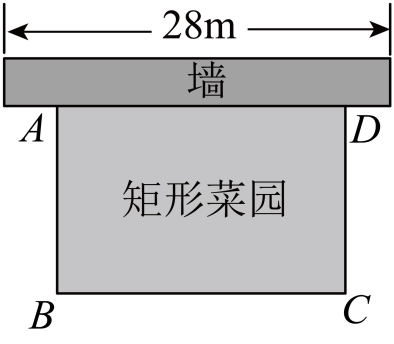

# Mathematics - 题目 1642

**ID**: 7259835dd5bd49d48330be2852f31d46
**年级**: Grade 9
**难度**: Medium
**题型**: Calculation

## 题目
如图，用一段长为 $46{\rm{m}}$ 的篱笆围成一个一边靠墙的矩形菜园，墙长为 $28{\rm{m}}$ ．设矩形菜园的边 $AB$ 的长为 $x{\rm{m}}$ ，面积为 $S{\rm{m}}{^{2}}$ ．(1)用含有 $x$ 的代数式表示 $BC$ 为m，x的取值范围为；​​​​​​​‌(2)当该矩形菜园的面积为 $84{\rm{m}}{^{2}}$ 时，求边 $AB$ 的长；(3)当边 $AB$ 的长为多少时，该矩形菜园的面积最大？最大面积是多少？

## 解答

1. （1）解：∵用一段长为 $46{\rm{m}}$ 的篱笆围成一个一边靠墙的矩形菜园，且设矩形菜园的边 $AB$ 的长为 $x{\rm{m}}$ ，面积为 $S{\rm{m}}{^{2}}$ ．
2. ∴ $BC$ 为 $\left ({46-2x}\right ){\rm{m}}$ ，
3. ∵ $0<46-2x\leqslant 28$
4. ∴ $9\leqslant x<23$ ；
5. （2）解：根据题意列方程 $\left ({46-2x}\right )x=84$ ，
6. 整理得 $-2x{^{2}}+46x=84$ ，
7. 解得 $x=2$ 或 $x=21$ ．
8. 当 $x=2$ 时， $46-2x=42>28$ ，故舍去，
9. ∴x取21，即 $AB=21{\rm{m}}$ .
10. （3）解：由已知得， $S=-2x{^{2}}+46x=-2{\left({x-11.5}\right)^{2}}+264.5$ ．
11. ∵ $-2<0$ ，
12. ∴S有最大值．
13. 当 $x=11.5$ 时， $46-2x=23<28$ ，
14. S最大值为264.5．
15. 即当边 $AB$ 为 $11.5{\rm{m}}$ 时，该矩形菜园的面积最大，最大面积是 $264.5{\rm{m}}{^{2}}$ ．

## 知识点

**中文**:
  - 二次函数的最值
  - 图形问题
  - 几何问题

**English**:
  - Maximum/Minimum of Quadratic Functions
  - Geometric Problems
  - Geometry Problems

---
