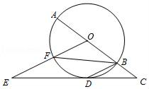

# Mathematics - 题目 327

**ID**: 736f8fbf11a640469c68053b8b585114
**年级**: Grade 9
**难度**: Medium
**题型**: Calculation

## 题目
如图，AB是⊙O的直径，C为AB延长线上一点，过点C作⊙O的切线CD，D为切点，点F是弧AD的中点，连接OF并延长交CD于点E，连接BD，BF．（1）求证：BD∥OE；​​​​​​​‌（2）若OE＝3 $\sqrt {10}$ ，tanC＝ $\frac {3}{4}$ ，求⊙O的半径．

## 解答

1. (1)∵OB=OF，
2. ∴∠1=∠3，
3. ∵点F是 $\overset ⌢{{AD}}$ 的中点，
4. ∴∠1=∠2，
5. ∴∠2=∠3，
6. ∴BD∥OE；
7. (2)连接OD，如图，
8. 
9. ∵直线CD是⊙O的切线，
10. ∴OD⊥CD，
11. 在Rt△OCD中，∵tanC= $\frac {OD}{CD}=\frac {3}{4}$ ，
12. ∴设OD=3k，CD=4k．
13. ∴OC=5k，BO=3k，
14. ∴BC=2k．
15. ∵BD∥OE，
16. ∴ $\frac {BC}{BO}=\frac {CD}{DE}$ ，
17. 即 $\frac {2k}{3k}=\frac {4k}{DE}$ ,
18. ∴DE=6k，
19. 在Rt△ODE中，∵OE^{2}=OD^{2}+DE^{2}，
20. ∴(3 $\sqrt {10}$ )^{2}=(3k)^{2}+(6k)^{2}，
21. 解得k= $\sqrt {2}$ ,
22. ∴OB=3 $\sqrt {2}$ ，
23. 即⊙O的半径的长3 $\sqrt {2}$ ．

## 知识点

**中文**:
  - 切线的性质定理
  - 圆周角定理及推论

**English**:
  - Tangent Properties Theorem
  - Inscribed Angle Theorem

---
