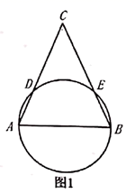
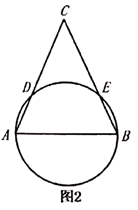

# Mathematics - 题目 3143

**ID**: 758671daac2a49789e276377feffdef9
**年级**: Grade 9
**难度**: Medium
**题型**: Calculation

## 题目
如图，以等腰三角形 $ABC$ 的底边 $AB$ 为直径的圆，与另两边 $AC、BC$ 分别交于点 $D、E$ ,请你仅用无刻度的直尺分别按下列要求画图(保留画图痕迹，不写画法)（1）在图1中，画一条直线与 $AB$ 平行．（2）在图2中，画一个以 $AB$ 为对角线的矩形．​​​​​​​‌

## 解答

1. （1）连接DE，DE即为所求；
2. 
3. （2）连接BD,AE相交于点M,连接CM并延长交AB于点O,连接DO并延长交圆于点N，连接AN,BN,四边形ADBN即为所求.
4. 

## 知识点

**中文**:
  - 圆周角定理及推论
  - 等腰三角形的性质
  - 矩形的判定

**English**:
  - Inscribed Angle Theorem
  - Properties of Isosceles Triangles
  - Determination of Rectangles

---
