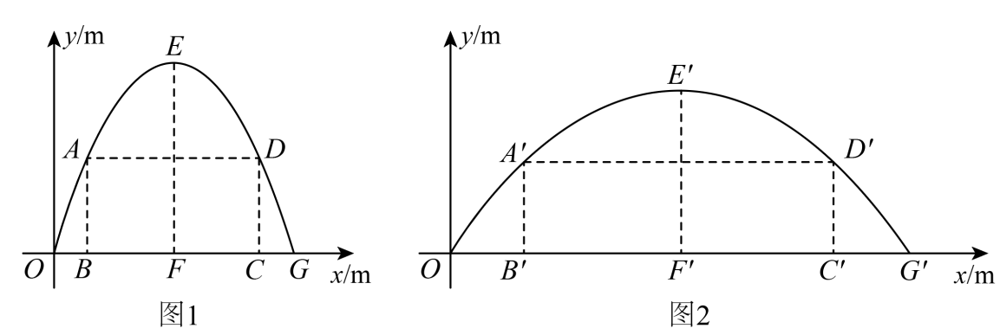

# Mathematics - 题目 523

**ID**: 7829cf8ea2c44a54905e57c64dd72b30
**年级**: Grade 9
**难度**: Medium
**题型**: Calculation

## 题目
某公司将新建的大门设计为一个抛物线型门，并要求所设计的拱门的跨度与拱高之积为 $48{\rm{m}}{^{2}}$ ，还要兼顾美观、大方，和谐、通畅等因素，设计部门按要求给出了两个设计方案．现把这两个方案中的拱门图形放入平面直角坐标系中，如图所示：方案一：如图1，抛物线型拱门的跨度 $OG=8{\rm{m}}$ ，拱高 $EF=6{\rm{m}}$ ．其中，点G在x轴上， $EF\bot OG,OF=FG$ ．方案二：如图2，抛物线型拱门的跨度 $OG^{′}=12{\rm{m}}$ ，拱高 $E^{′}F^{′}=4{\rm{m}}$ ．其中，点 $G^{′}$ 在x轴上， $E^{′}F^{′}{\bot }OG^{′},OF^{′}=F^{′}G^{′}$ ．要在拱门中设置高为3m的矩形框架，其面积越大越好（框架的粗细忽略不计）．方案一中，矩形框架 $ABCD$ 的面积记为 $S{{}_{1}}$ ，点A，D在抛物线上，边 $BC$ 在 $OG$ 上；​​​​​​​‌方案二中，矩形框架 $A^{′}B^{′}C^{′}D$ 的面积记为 $S{{}_{2}}$ ，点 $A^{′}$ ， $D^{′}$ 在抛物线上，边 $B^{′}C^{′}$ 在 $OG^{′}$ 上．现知，小明已正确求出方案二中，当 $A^{′}B^{′}=3$ 时， $S{{}_{2}}=18{\rm{m}}{^{2}}$ ，请你根据以上提供的相关信息，解答下列问题：(1)求方案一中抛物线的函数表达式；(2)在方案一中，当 $AB=3{\rm{m}}$ 时，①求矩形框架 $ABCD$ 的面积 $S{{}_{1}}$ ；②比较 $S{{}_{1}}$ ， $S{{}_{2}}$ 的大小，并给出公司最后确定用的是方案几．

## 解答

1. （1）解：由题意得， $G\left ({8,0}\right )$ ， $E\left ({4,6}\right )$ ，
2. 设解析式为： $y=a{\left({x-4}\right)^{2}}+6\left ({a\ne 0}\right )$ ，
3. 代入 $G\left ({8,0}\right )$ 得： $16a+6=0$ ，
4. 解得： $a=-\frac {3}{8}$ ，
5. ∴方案一抛物线的函数表达式为： $y=-\frac {3}{8}{\left({x-4}\right)^{2}}+6$ ；
6. （2）解：①把 $y=3$ 代入 $y=-\frac {3}{8}{\left({x-4}\right)^{2}}+6$ 得： $-\frac {3}{8}{\left({x-4}\right)^{2}}+6=3$ ，
7. 解得： $x{{}_{1}}=4-2\sqrt {2},x{{}_{2}}=4+2\sqrt {2}$ ，
8. ∴ $BC=4+2\sqrt {2}-\left ({4-2\sqrt {2}}\right )=4\sqrt {2}$ ，
9. ∴ $S{{}_{1}}=4\sqrt {2}\times 3=12\sqrt {2}$ ；
10. ②∵ $18>12\sqrt {2}$ ，
11. ∴ $S{{}_{2}}>S{{}_{1}}$ ，
12. ∵兼顾美观、大方，和谐、通畅等因素，且 $S{{}_{2}}>S{{}_{1}}$ ， $AB=A^{′}B^{′}=3{\rm{m}}$ ，
13. ∴用方案二．

## 知识点

**中文**:
  - 二次函数与一元二次方程
  - 其他问题

**English**:
  - Quadratic Functions and Quadratic Equations
  - Other Problems

---
