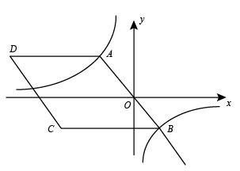

# Mathematics - 题目 1715

**ID**: 78340365c461432087cf259d9a269cc4
**年级**: Grade 9
**难度**: Medium
**题型**: Calculation

## 题目
如图，反比例函数 $y=\frac {k}{x}\left ({k\ne 0}\right )$ 的图象与正比例函数 $y=-\frac {3}{2}x$ 的图象相交于 $A\left ({a,3}\right )$ ，B两点．(1)求k的值及点B的坐标；​​​​​​​‌(2)请直接写出不等式 $\frac {k}{x}>-\frac {3}{2}x$ 的解集；(3)已知 $AD{\rm{/\mskip-4mu/}}x$ 轴，以AB,AD为边作菱形ABCD，求菱形ABCD的面积．

## 解答

1. （1）解：将A(a，3)代入 $y{\rm{=}}{\rm{-}}\frac {3}{2}x$ ，得a=-2，
2. ∴A(-2，3)，
3. 将A(-2，3)代入 $y=\frac {k}{x}$ ，得 $3=\frac {k}{-2}$ ，得k=-6，
4. ∴k=-6，
5. ∵点B是反比例函数 $y={\rm{-}}\frac {6}{x}$ 与正比例函数 $y{\rm{=}}{\rm{-}}\frac {3}{2}x$ 的交点，点B在第四象限，
6. ∴ $\begin{cases}y={\rm{-}}\frac {6}{x},\\y={\rm{-}}\frac {3}{2}x,\end{cases}$  解得  $\begin{cases}x{{}_{1}}=2，\\y{{}_{1}}=-3\end{cases}$ 和 $\begin{cases}x{{}_{2}}=-2，\\y{{}_{2}}=3\end{cases}$ （舍去），
7. ∴B（2，-3）.
8. （2）∵A(-2，3)，B（2，-3），k=-6，
9. ∴ $\frac {-6}{x}$ ＞ ${\rm{-}}\frac {3}{2}x$ ，
10. ∵k＜0，反比例函数在每个象限内，y的值随x的值增大而增大，
11. 正比例函数中，y的值随x的值增大而减小，
12. 再结合图形可知，不等式 $\frac {-6}{x}$ ＞ ${\rm{-}}\frac {3}{2}x$ 的解集为x＞2和-2＜x＜0.
13. （3）如下图，作AE⊥BC，
14. 
15. ∵A(-2，3)，B（2，-3），
16. ∴AE=6，BE=4，
17. ∴ $AB=\sqrt {AE{^{2}}+BE{^{2}}}=\sqrt {6{^{2}}+4{^{2}}}=2\sqrt {13}$ ，
18. ∵四边形ABCD是菱形，
19. ∴AB=CB，
20. ∵S_{菱形}=BC×AE= $2\sqrt {13}\times 6=12\sqrt {13}$  ．

## 知识点

**中文**:
  - 反比例函数综合
  - 反比例函数解析式

**English**:
  - Comprehensive Inverse Proportionality Problems
  - Analytic Expression of Inverse Proportionality

---
