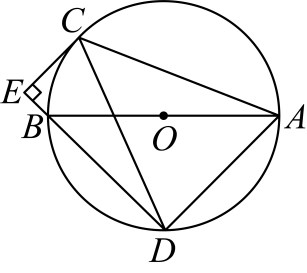

# Mathematics - 题目 3502

**ID**: 78d8c2801993433fa539bdf5c944336d
**年级**: Grade 9
**难度**: Medium
**题型**: Calculation

## 题目
如图， $AB$ 为的直径，点C、点D为 $\odot O$ 上异于A、B的两点，连接 $CD$ ，过点C作 $CE\bot DB$ ，交 $DB$ 的延长线于点E，连接 $AC、AD$ ．（1）若 $\angle ABD=2\angle BDC$ ，求证： $CE$ 是 $\odot O$ 的切线；​​​​​​​‌（2）若 $\odot O$ 的半径为 $2\sqrt {10}$ ， ${\tan}\angle BDC=\frac {1}{3}$ ，求 $AC$ 的长．

## 解答

1. （1）解：连接 $OC$ ，
2. 
3. ∵ $OC=OA$ ，
4. ∴ $\angle OCA=\angle OAC$ ，
5. ∴ $\angle COB=2\angle OAC$ ，
6. ∵ $\angle BDC=\angle OAC，\angle ABD=2\angle BDC$ ，
7. ∴ $\angle COB=\angle ABD$ ，
8. ∴ $OC/\mskip-4mu/DE$ ，
9. ∵ $CE\bot DB，\angle CED=90{}\degree $ ，
10. ∴ $\angle OCE=90{}\degree ，OC\bot CE$ ，
11. ∴ $CE$ 是 $\odot O$ 的切线．
12. （2）连接 $BC$ ，
13. 
14. ∵ $\angle BDC=\angle BAC$ ，
15. ∴ ${\tan}\angle BAC={\tan}\angle BDC=\frac {1}{3}$
16. ∵ $AB$ 是 $\odot O$ 的直径，
17. ∴ $\angle BCA=90{}\degree ，$
18. ∴ $\frac {BC}{AC}=\frac {1}{3}$ ，
19. 设 $BC=x，AC=3x$ ，
20. ∴ $AB=\sqrt {10}x$ ，
21. ∵ $\odot O$ 的半径为 $2\sqrt {10}$ ，
22. ∴ $\sqrt {10}x=4\sqrt {10}$ ，
23. ∴ $x=4$ ，
24. ∴ $AC=3x=12$ ．

## 知识点

**中文**:
  - 切线的判定定理
  - 解直角三角形
  - 半圆（或直径）所对的圆周角是直角

**English**:
  - Tangent Determination Theorem
  - Solving Right Triangles
  - Angle in a Semicircle is Right

---
