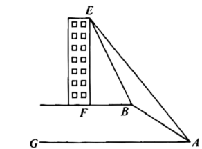

# Mathematics - 题目 3167

**ID**: 7c04198b42e7400f883d880e61495ca6
**年级**: Grade 9
**难度**: Medium
**题型**: Calculation

## 题目
数学兴趣小组测量某楼房的高度．如图所示，楼房剖面和台阶的剖面在同一平面，在台阶底部点 $A$ 处测得楼顶端点 $E$ 的仰角 $\angle GAE=50.​​​​​​​‌2{}^\circ $ ，台阶 $AB$ 长39米，台阶坡面 $AB$ 的坡度 $i=5:12$ ，然后在点 $B$ 处测得楼顶端点 $E$ 的仰角 $\angle EBF=63.4{}^\circ $ ，则楼顶到地面的高度 $EF$ 约为多少米．（参考数据： ${\tan}50.2{}^\circ \approx 1.20$ ， ${\tan}63.4{}^\circ \approx 2.00$ ， ${\sin}50.2{}^\circ \approx 0.77$ ， ${\sin}63.4{}^\circ \approx 0.89$ ）

## 解答

1. 解：如图，延长 $EF$ 交 $AG$ 于点 $H$ ，则 $EH\bot AG$ ，作 $BP\bot AG$ 于点 $P$ ，则四边形 $BFHP$ 是矩形，
2. 
3. $\therefore FB=PH$ ， $FH=PB$ ，
4. 由 $i=5:12$ ，可以假设 $BP=5x$ ， $AP=12x$ ，
5. $\because PB{{}^{2}}+PA{{}^{2}}=AB{{}^{2}}$ ，
6. $\therefore (5x){{}^{2}}+(12x){{}^{2}}=39{{}^{2}}$ ，
7. $\therefore x=3$ 或 $-3$ （舍去），
8. $\therefore PB=FH=15$ ， $AP=36$ ，
9. 设 $EF=a$ 米， $BF=b$ 米，
10. $\because {\tan}\angle EBF=\frac {EF}{BF}$ ，
11. $\therefore $  $\frac {a}{b}\approx 2$ ，
12. $\therefore a\approx 2b$ ①，
13. $\because {\tan}\angle EAH=\frac {EH}{AH}=\frac {EF+HF}{AP+PH}=\frac {EF+BP}{AP+BF}$ ，
14. $\therefore $  $\frac {a+15}{36+b}\approx 1.2$ ②，
15. 由①②得 $a\approx 70.5$ ， $b\approx 35.25$ ，
16. 答：塔顶到地面的高度 $EF$ 约为70.5米．
17. 【点睛】本题考查解直角三角形的应用，解题的关键是学会添加常用辅助线，构造直角三角形解决问题，学会利用参数，构建方程组解决问题．

## 知识点

**中文**:
  - 解直角三角形
  - 解直角三角形的实际应用

**English**:
  - Solving Right Triangles
  - Applications of Solving Right Triangles

---
