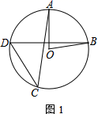
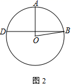

# Mathematics - 题目 3049

**ID**: 7c8772433b4d4420af5d439a1fff5eb7
**年级**: Grade 9
**难度**: Medium
**题型**: Calculation

## 题目
如图，在⊙O中，半径OA与弦BD垂直，点C在⊙O上，∠AOB＝80°(1) 若点C在优弧BD上，求∠ACD的大小(2) 若点C在劣弧BD上，直接写出∠ACD的大小​​​​​​​‌

## 解答

1. 解：（1）∵AO⊥BD，
2. ∴ $\overset ⌢{{AD}}=\overset ⌢{{AB}}$ ，
3. ∴∠AOB=2∠ACD，
4. ∵∠AOB=80°，
5. ∴∠ACD=40°；
6. （2）如图，①当点C_{1}在 $\overset ⌢{{AB}}$ 上时，∠AC_{1}D=∠ACD=40°；
7. ②当点C_{2}在 $\overset ⌢{{AD}}$ 上时，∵∠AC_{2}D+∠ACD=180°，∴∠AC_{2}D=140°.
8. 综上所述，∠ACD=40°或140°．
9. 

## 知识点

**中文**:
  - 圆周角定理及推论
  - 垂径定理的应用

**English**:
  - Inscribed Angle Theorem
  - Applications of Perpendicular Chord Theorem

---
