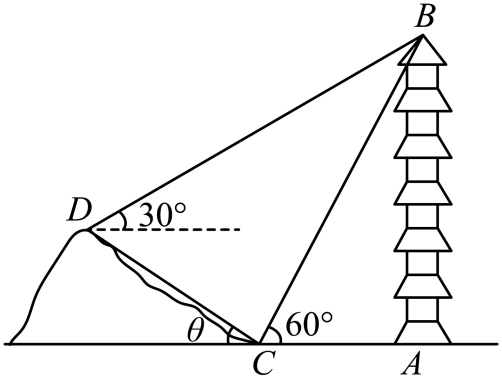

# Mathematics - 题目 3047

**ID**: 800397a2959c49c08dc4ef189f79cf0c
**年级**: Grade 9
**难度**: Medium
**题型**: Calculation

## 题目
在一次综合实践活动中，某小组对一建筑物进行测量．如图，在山坡坡脚C处测得该建筑物顶端B的仰角为60°，沿山坡向上走20m到达D处，测得建筑物顶端B的仰角为30°．已知山坡坡度 $i=3:4$ ，即 ${\tan}θ=\frac {3}{4}$ ，请你帮助该小组计算建筑物的高度 $AB$ ．（结果精确到0.​​​​​​​‌1m，参考数据： $\sqrt {3}\approx 1.732$ ）

## 解答

1. 作 $DE\bot AC$ 交 $AC$ 于点E，作 $DF\bot AB$ 交 $AB$ 于点F，
2. 作 $CH\bot DF$ 交 $DF$ 于点H，
3. 则 $DE=AF$ ， $HF=AC$ ， $DH=CE$ ，
4. ∵ ${\tan}θ=\frac {3}{4}$ ，
5. ∴设 $DE=3x$ ，则 $CE=4x$ ，
6. 
7. 在 $\mathrm{R}\mathrm{t}\mathrm{△}CDE$ 中， $\angle E=90{}^\circ $ ,
8. ∴ $DE{^{2}}+CE{^{2}}=CD{^{2}}$ ,
9. ∴ $(3x){^{2}}+(4x){^{2}}=20{^{2}}$ ,
10. ∴ $x=4$ （负值舍去）,
11. ∴ $DE=12$ ， $CE=16$ ,
12. ∴ $AF=DE=12$ ， $DH=CE=16$ ,
13. 设 $BF=y$ ，则 $AB=(y+12)$ ,
14. 在 $\mathrm{R}\mathrm{t}\mathrm{△}BDF$ 中， $\angle BDF=30{}^\circ $ ,
15. ∵ ${\tan}\angle BDF=\frac {BF}{DF}$ ,
16. ∴ $DF=\sqrt {3}y$ ,
17. 在 ${\rm{R}}{\rm{t}}\vartriangle ABC$ 中， $\angle ACB=60{}^\circ $ ,
18. ∵ ${\tan}\angle ACB=\frac {AB}{AC}$ ,
19. ∴ $AC=\frac {\sqrt {3}}{3}(y+12)$ ,
20. 即 $HF=AC=\frac {\sqrt {3}}{3}(y+12)$ ,
21. ∵ $DF-FH=DH$ ,
22. ∴ $\sqrt {3}y-\frac {\sqrt {3}}{3}(y+12)=16$ ,
23. ∴ $y=(6+8\sqrt {3})$ ,
24. ∴ $AB=BF+FA=6+8\sqrt {3}+12=18+8\sqrt {3}\approx 31.9({\rm{m}})$ .
25. 答：该建筑物 $AB$ 的高度约为31.9m．

## 知识点

**中文**:
  - 解直角三角形
  - 解直角三角形的实际应用

**English**:
  - Solving Right Triangles
  - Applications of Solving Right Triangles

---
