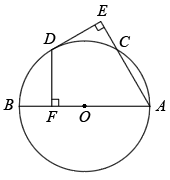

# Mathematics - 题目 3615

**ID**: 826ffd8c52f248dd88c01afff0f3b53d
**年级**: Grade 9
**难度**: Medium
**题型**: Calculation

## 题目
如图， $AB$ 为⊙O直径，C为⊙O上一点，点D是 $\overset{\frown}{{BC}}$ 的中点， $DE\mathrm{⊥}AC$ 于 ${\rm \mathit{E}，}DF\bot AB$ 于F．(1)求证： $DE$ 是⊙O的切线；​​​​​​​‌(2)若 $OF=4$ ，求 $AC$ 的长度．

## 解答

1. （1）连接 $OD,AD$ ,
2. 
3. ∵点D是 $\overset{\frown}{{BC}}$ 的中点，
4. ∴ $\angle BAD=\angle CAD$ ，
5. ∵ $OD=OA$ ，
6. ∴ $\angle BAD=\angle ODA$ ,
7. ∴ $\angle ODA=\angle CAD$ ,
8. ∴ $OD{\rm{/\mskip-4mu/}}AE$ ,
9. ∴ $\angle ODE+\angle E=180{}\degree $ ,
10. ∵ $DE\bot AC$ 于E，
11. ∴ $\angle E=90{}\degree $ ,
12. ∴ $\angle ODE=90{}\degree $ ,
13. ∴ $OD⊥DE$ ,
14. 又∵ $OD$ 是半径，
15. ∴ $DE$ 是⊙O的切线.
16. （2）过点O作 $OH\bot AC{\rm \mathit{，}}$ 垂足为H．
17. 
18. ∴ $AH=\frac {1}{2}AC,\angle OFD=\angle AHO$ ，
19. ∵ $OD{\rm{/\mskip-4mu/}}AE$ ，
20. ∴ $\angle DOF=\angle A$ ．
21. 又∵ $OD=OA$ ，
22. ∴ $\vartriangle OFD\cong \vartriangle AHO$ ，
23. ∴ $OF=AH$ ,
24. ∵ $AH=\frac {1}{2}AC,OF=4$ ，
25. ∴ $AC=8$ ．

## 知识点

**中文**:
  - 切线的判定定理
  - 垂径定理及其推论

**English**:
  - Tangent Determination Theorem
  - Perpendicular Chord Theorem

---
