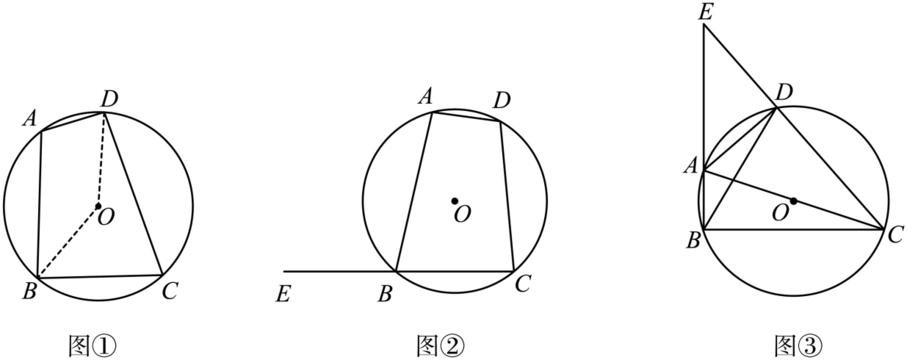

# Mathematics - 题目 1046

**ID**: 83049b155a284e1e873b9627237bdf81
**年级**: Grade 9
**难度**: Medium
**题型**: Calculation

## 题目
【问题原型】小明在学习华师版教材九年级下册第二十七章时遇到这样一个问题：“求证：圆的内接四边形对角互补”，如图①，小明给出了如下证明方法：证明：连结 $OB$ ， $OD$ ．$\because $  $\angle A$ 所对的弧为 $\overset{\frown}{{BCD}}$ ， $\angle C$ 所对的弧为 $\overset{\frown}{{BAD}}$ ，又 $\overset{\frown}{{BCD}}$ 和 $\overset{\frown}{{BAD}}$ 所对的圆心角的和是周角，$\therefore $  $\angle A+\angle C=\frac {360{}\degree }{2}=180{}\degree $ ，同理 $\angle ABC+\angle ADC=180{}\degree $ ．这样，利用圆周角定理，我们得到了圆内接四边形的一个性质：圆的内接四边形对角互补．【应用】（1）如图②，四边形 $ABCD$ 内接于 $\mathrm{⊙}O$ ， $E$ 为 $CB$ 延长线上一点，若 $\angle D=110{}\degree $ ，则 $\angle ABE=$；​​​​​​​‌【探究】如图③，四边形 $ABCD$ 为 $\mathrm{⊙}O$ 的内接四边形， $AC$ 为 $\mathrm{⊙}O$ 的直径 ${\rm ．}DB=DC$ ，延长 $BA$ ， $CD$ 相交于点 $E$ ；（2）求证： $\angle EAD=\angle CAD$ ；（3）若 $BC=24$ ， $\sin \angle BAC=\frac {12}{13}$ ，则四边形 $ABCD$ 的面积为．

## 解答

1. 解：（1）∵ $\angle ABC+\angle ADC=180{}\degree $ ， $\angle ABC+\angle ABE=180{}\degree $ ，且 $\angle D=110{}\degree $ ，
2. ∴ $\angle ABE=\angle D=110{}\degree $ ．
3. 故答案为 $110{}\degree $ ．
4. （2）∵ $DB=DC$ ，
5. ∴ $\angle CBD=\angle BCD$ ，
6. ∵ $\angle CAD=\angle CBD$ ，
7. ∴ $\angle CAD=\angle BCD$ ，
8. ∵ $AC$ 为 $\mathrm{⊙}O$ 的直径，
9. ∴ $\angle ADC=\angle ABC=90{}\degree $ ，
10. ∴ $\angle E+\angle BCD=\angle E+\angle EAD=90{}\degree $ ，
11. 则 $\angle BCD=\angle EAD$ ，
12. ∴ $\angle EAD=\angle CAD$ ．
13. （3） ∵ $BC=24$ ， $\sin \angle BAC=\frac {BC}{AC}=\frac {12}{13}$ ， $\angle ABC=90{}\degree $ ，
14. ∴ $AC=26$ ，
15. ∴ $AB=\sqrt {AC{^{2}}-BC{^{2}}}=10$ ，
16. 由（1）知 $\begin{cases}\angle EAD=\angle CAD\\AD=AD\\\angle EDA=\angle CDA\end{cases}$ ，
17. ∴ $\mathrm{△}EAD≌\mathrm{△}CAD\left ({\mathrm{A}\mathrm{S}\mathrm{A}}\right )$ ，
18. ∴ $CD=ED=BD$ ， $AE=AC=26$ ，
19. ∴ $BE=AB+AE=36$ ，
20. ∵ $CE=\sqrt {BE{^{2}}+BC{^{2}}}=12\sqrt {13}$ ，
21. ∴ $CD=ED=6\sqrt {13}$ ，
22. ∴ $AD=\sqrt {AC{^{2}}-CD{^{2}}}=4\sqrt {13}$ ，
23. ∴ $S{{}_{四边形ABCD}}=S{{}_{\mathrm{△}ABC}}+S{{}_{\mathrm{△}ACD}}$
24. $=\frac {1}{2}AB\cdot BC+\frac {1}{2}AD\cdot CD$
25. $=\frac {1}{2}\left ({10\times 24+4\sqrt {13}\times 6\sqrt {13}}\right )$
26. $=276$ ．

## 知识点

**中文**:
  - 圆周角定理及推论
  - 解直角三角形

**English**:
  - Inscribed Angle Theorem
  - Solving Right Triangles

---
