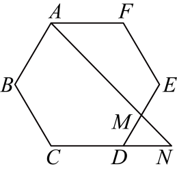

# Mathematics - 题目 2273

**ID**: 83a2bdd4fee940478e1bb3298d3066fb
**年级**: Grade 9
**难度**: Medium
**题型**: Calculation

## 题目
如图，在正六边形 $ABCDEF$ 中，点M是边 $DE$ 的中点，连接 $AM$ 并延长交 $CD$ 延长线于N点．(1)求证： $AF/\mskip-4mu/CN$ ；​​​​​​​‌(2)若 $AF=2$ ，求 $DN$ 的长．

## 解答

1. （1）解：连接 $BE$ ，
2. 
3. ∵六边形 $ABCDEF$ 是正六边形，
4. ∴ $\angle F=\angle CDE=\angle DEF=120{}\degree $ ，
5. ∵ $BE$ 是正六边形的对称轴，
6. ∴ $\angle FEB=\angle BED=60{}\degree $ ，
7. ∴ $\angle F+\angle FEB=180{}\degree $ ，
8. ∴ $AF\mathrm{/\mskip-4mu/}BE$ ，
9. 同理可证 $CN\mathrm{/\mskip-4mu/}BE$ ，
10. ∴ $AF\mathrm{/\mskip-4mu/}CN$ ；
11. （2）解：延长 $AF，DE$ 交于G点，
12. 
13. ∴ $\angle GFE=\angle GEF=60{}\degree $ ，
14. ∴ $\mathrm{△}GEF$ 是等边三角形，
15. ∴ $FG=GE=EF=AF=2$ ，
16. ∴ $AG=4$ ， $GM=3$ ， $DM=1$ ，
17. ∵ $AF\mathrm{/\mskip-4mu/}CN$ ，
18. $\therefore \mathrm{△}AGM∽\mathrm{△}NDM$ ，
19. ∴ $\frac {AG}{DN}=\frac {MG}{MD}=3$ ，
20. ∴ $DN=\frac {4}{3}$ ．

## 知识点

**中文**:
  - 正多边形的概念和性质
  - 等边三角形的判定与性质
  - 相似三角形的判定与性质综合

**English**:
  - Regular Polygons Concepts
  - Determination and Properties
  - Determination and Properties

---
