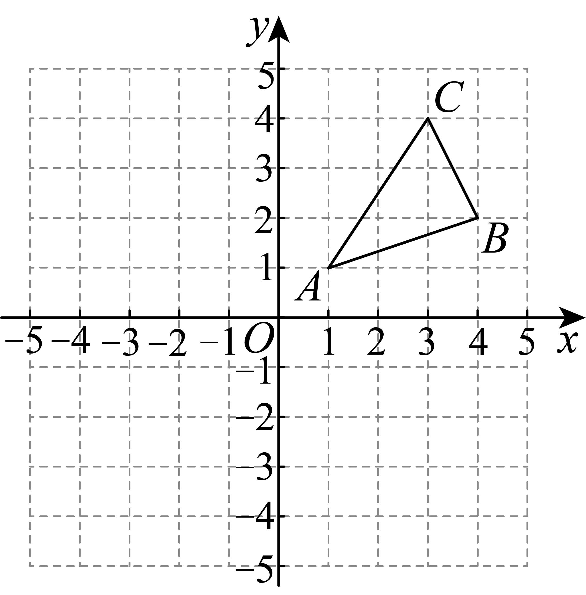

# Mathematics - 题目 3960

**ID**: 8562fba39aca4320b6d5cec95477fc6e
**年级**: Grade 9
**难度**: Medium
**题型**: Calculation

## 题目
如图， $\vartriangle ABC$ 三个顶点的坐标分别为 $A\left ({1,1}\right )$ ， $B\left ({4,2}\right ),C\left ({3,4}\right )$ ．（1）作出将 $\vartriangle ABC$ 向左平移4个单位，向上平移1个单位后得到的图形 $\mathrm{△}A{{}_{1}}B{{}_{1}}C{{}_{1}}$ ；​​​​​​​‌（2）作出 $\vartriangle ABC$ 关于原点 $\left ({0,0}\right )$ 成中心对称的图形 $\vartriangle A{{}_{2}}B{{}_{{{2}}}}C{{}_{2}}$ ；（3）若将 $\vartriangle ABC$ 绕点A顺时针旋转 $90{}\degree $ ，则点C的对应点 $C{{}_{{{3}}}}$ 的坐标是（无需作图）

## 解答

1. （1）解：如图， $\mathrm{△}A{{}_{1}}B{{}_{1}}C{{}_{1}}$ 即为所求；
2. 
3. （2）如图， $\vartriangle A{{}_{2}}B{{}_{{{2}}}}C{{}_{2}}$ 即为所求，
4. （3）将 $\vartriangle ABC$ 绕点A顺时针旋转 $90{}\degree $ ，则点C的对应点 $C{{}_{{{3}}}}$ 的坐标是 $\left ({4,-1}\right )$ .

## 知识点

**中文**:
  - 作图——平移
  - 坐标与图形变换——旋转
  - 关于原点对称的点的坐标

**English**:
  - Construction: Translation
  - Coordinates and Rotation
  - Points Symmetric about Origin

---
