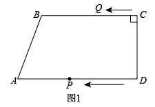
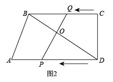

# Mathematics - 题目 986

**ID**: 86e920712a6e4a7bbf7da34d41afc90b
**年级**: Grade 9
**难度**: Medium
**题型**: Calculation

## 题目
如图1，在四边形ABCD中，AD∥BC，∠C＝90°，BC＝8cm，DC＝6cm，AD＝11cm，点P以2cm/s的速度沿DA边由点D向点A运动；​​​​​​​‌同时点Q以1cm/s的速度沿CB边由点C向点B运动，而且当其中一点停止运动时另一点也停止运动．设运动时间为t（s）．(1)用含t的代数式表示下面线段的长度．①CQ＝cm；②PD＝cm；③BQ＝cm；④AP＝cm；(2)如图1，当t为s时，PQ∥AB．(3)如图2，是否存在某一时刻t，使得PQ⊥BD．若存在，求出t值；若不存在，请说明理由．

## 解答

1. （1）∵点P以2cm/s的速度沿DA边由点D向点A运动；同时点Q以1cm/s的速度沿CB边由点C向点B运动，
2. ∴QC＝tcm，PD＝2tcm，
3. ∵BC＝8cm，AD＝11cm，
4. ∴BQ＝（8﹣t）cm，AP＝（11﹣2t）cm，
5. （2）∵PQ∥AB，BC∥AD，
6. ∴四边形ABQP是平行四边形，
7. ∴BQ＝AP，
8. ∴8﹣t＝11﹣2t，
9. ∴t＝3，
10. 故答案为：3；
11. （3）存在，
12. ∵ ${\rm ∠\mathit{C}＝90°，\mathit{BC}＝8\mathit{cm}，\mathit{DC}＝6\mathit{cm}}$ ，
13. ∴ $BD=\sqrt {{\rm{B}}{\rm{C}}{^{2}}+{\rm{C}}{\rm{D}}{^{2}}}=\sqrt {36+64}=10({\rm{c}}{\rm{m}})$ ，
14. ∵PQ⊥BD，
15. ∴ ${\rm ∠\mathit{BOQ}＝90°＝∠\mathit{C}}$ ，
16. 又∵ ${\rm ∠\mathit{DBC}＝∠\mathit{QBO}}$ ，
17. ∴ ${\rm △\mathit{OBQ}∽△\mathit{CBD}}$ ，
18. ∴ $\frac {BO}{BQ}=\frac {CB}{BD}$ ，
19. ∴ $\frac {{\rm{B}}{\rm{O}}}{8-{\rm{t}}}=\frac {8}{10}$ ，
20. ∴ ${\rm \mathit{BO}＝}\frac {4}{5}$ （8﹣t），
21. ∴ $DO=10-\frac {4}{5}(8-t)=\frac {18}{5}+\frac {4}{5}t$ ，
22. ∵BC∥AD，
23. ∴ ${\rm △\mathit{BQO}∽△\mathit{DPO}}$ ，
24. ∴ $\frac {BQ}{DP}=\frac {BO}{DO}$ ，
25. ∴ $\frac {8-t}{2t}=\frac {\frac {4}{5}(8-t)}{\frac {18}{5}+\frac {4}{5}t}$
26. ∴ ${\rm \mathit{t}\mathit{_{1}}＝}\frac {9}{2}$ ，t_{2}＝8（不合题意舍去），
27. ∴当 ${\rm \mathit{t}＝}\frac {9}{2}$ 时，使得PQ⊥BD．

## 知识点

**中文**:
  - 平行四边形的判定与性质
  - 相似三角形的判定与性质综合

**English**:
  - Determination and Properties
  - Determination and Properties

---
