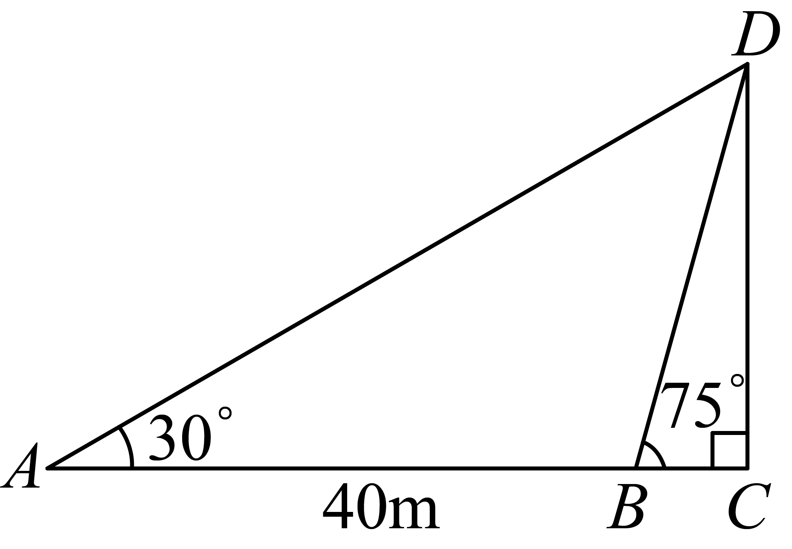

# Mathematics - 题目 2847

**ID**: 8f884c9b317647d4ae6c79062951f7c5
**年级**: Grade 9
**难度**: Medium
**题型**: Calculation

## 题目
某学习小组带着测角仪开展“测量高压电塔高度”的实践活动，绘制了如下示意图．在A处测得塔顶D的仰角为 $30{}\degree $ ，向前行40米，在B处测得塔顶D的仰角为 $75{}\degree {\rm ，\mathit{A}}$ 、B与电塔底部C在同一直线上．（1）求点B到 $AD$ 的距离；​​​​​​​‌（2）求高压电塔 $CD$ 的高度（结果保留根号）．

## 解答

1. （1）解：如图，作 $BE\bot AD$ 于点 $E$ ，
2. $\because \angle A=30{}\degree $ ，
3. $\therefore BE=\sin 30{}\degree \times AB=\frac {1}{2}\times AB=20{\rm{m}}$ ；
4. （2）解：由（1）得： $AE={\cos}30{}\degree \times AB=\frac {\sqrt {3}}{2}\times 40=20\sqrt {3}\left ({{\rm{m}}}\right )$
5. $\because \angle DBC=75{}\degree $ ，
6. $\therefore \angle ADB=\angle DBC-\angle A=75{}\degree -30{}\degree =45{}\degree $
7. $\therefore \angle EDB=90{}\degree -45{}\degree =45{}\degree $ ，
8. $\therefore DE=BE=20{\rm{m}}$ ，
9. $\therefore AD=AE+DE=\left ({20+20\sqrt {3}}\right ){\rm{m}}$ ，
10. $\because \angle C=90{}\degree $ ， $\angle A=30{}\degree $ ，
11. $\therefore CD=\sin 30{}\degree \times AD=\frac {1}{2}AD=\left ({10+10\sqrt {3}}\right ){\rm{m}}$ ．

## 知识点

**中文**:
  - 解直角三角形
  - 解直角三角形的实际应用

**English**:
  - Solving Right Triangles
  - Applications of Solving Right Triangles

---
