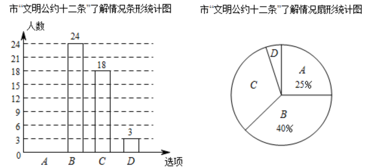

# Mathematics - 题目 774

**ID**: 912294c6fea24336b526094bfc480fae
**年级**: Grade 9
**难度**: Medium
**题型**: Calculation

## 题目
为了响应市政府创建文明城市的号召，某校调查学生对市“文明公约十二条”的内容了解情况，随机抽取部分学生进行问卷调查，问卷共设置“非常了解”、“比较了解”、“一般了解”、“不了解”四个选项，分别记为 $A$ 、 $B$ 、 $C$ 、 $D$ ，根据调查结果绘制了如下尚不完整的统计图．请解答下列问题：（1）本次问卷共随机调查了名学生，扇形统计图中 $C$ 选项对应的圆心角为度；​​​​​​​‌（2）请补全条形统计图；（3）若该校有1200名学生，试估计该校选择“不了解”的学生有多少人？

## 解答

1. （1）本次问卷共随机调查的学生人数为 $24\div 40\%=60$ （名）
2. C选项学生人数的占比为 $\frac {18}{60}\times 100\%=30\%$
3. 则 $30\%\times 360{}^\circ =108{}^\circ $
4. 故答案为：60，108；
5. （2）A选项学生的人数为 $60\times 25\%=15$ （名）
6. 因此补全条形统计图如下所示：
7. 
8. （3）选择“不了解”的学生的占比为 $\frac {3}{60}\times 100\%=5\%$
9. 则 $1200\times 5\%=60$ （人）
10. 答：该校选择“不了解”的学生有60人．

## 知识点

**中文**:
  - 扇形统计图
  - 用样本估计总体
  - 条形统计图

**English**:
  - Pie Charts
  - Estimating Population from Sample
  - Bar Charts

---
