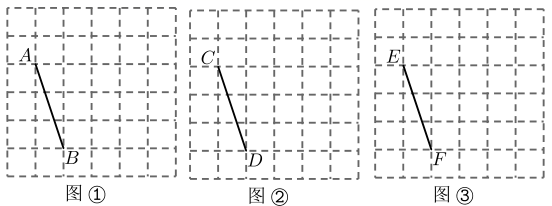

# Mathematics - 题目 319

**ID**: 918019488c4d446ab4f425716e698ff9
**年级**: Grade 9
**难度**: Medium
**题型**: Calculation

## 题目
图①、图②、图③均是 $6\times 6$ 的正方形网格，每个小正方形的顶点称为格点，小正方形的边长均为1，点 $A$ 、 $B$ 、 $C$ 、 $D$ 、 $E$ 、 $F$ 均在格点上．只用无刻度的直尺按下列要求在给定的网格中画图，所图形的顶点均在格点上，且在图①、图②、图③中所画的图形互相不全等，不要求写画法．（1）在图①中以线段 $AB$ 为一腰画一个等腰 $△ABP$ ．（2）在图②中以线段 $CD$ 为底画一个等腰 $\vartriangle CDM$ ．（3）在图③中以线段 $EF$ 为一边画一个等腰 $Rt\mathrm{△}EFN$ ，你所画的 $\vartriangle EFN$ 的面积为．​​​​​​​‌

## 解答

1. （1）图①中，
2. 
3. $BA=\sqrt {1{^{2}}+3{^{2}}}=\sqrt {10}$ ， $BP=\sqrt {1{^{2}}+3{^{2}}}=\sqrt {10}$ ，
4. ∴ $BA=BP$ ，
5. ∴ $△ABP$ 即所求．
6. （2）图②中，
7. 
8. $CM=\sqrt {1{^{2}}+2{^{2}}}=\sqrt {5}$ ， $DM=\sqrt {1{^{2}}+2{^{2}}}=\sqrt {5}$ ，
9. ∴ $CM=DM$ ，
10. ∴ $\vartriangle CDM$ 即所求．
11. （3）图③中，
12. 
13. $EF{^{2}}=1{^{2}}+3{^{2}}=10$ ， $EN{^{2}}=1{^{2}}+3{^{2}}=10$ ， $FN{^{2}}=2{^{2}}+4{^{2}}=20$ ，
14. ∴ $EF{^{2}}=EN{^{2}}$ ， $EF{^{2}}+EN{^{2}}=20=FN{^{2}}$ ，
15. ∴ $EF=EN=\sqrt {10}$ ，
16. ∴ $\vartriangle EFN$ 是等腰直角三角形，
17. ∴ $\vartriangle EFN$ 即所求，
18. $S{{}_{△EFN}}=\frac {1}{2}\cdot \sqrt {10}\cdot \sqrt {10}=5$ ．
19. 故答案为：5．

## 知识点

**中文**:
  - 尺规作图——作三角形
  - 等腰三角形的判定与性质

**English**:
  - Construction: Drawing Triangles
  - Determination and Properties

---
