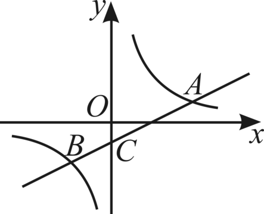

# Mathematics - 题目 1140

**ID**: 95fb074f027a4b32bfbd247eaf4d3183
**年级**: Grade 9
**难度**: Medium
**题型**: Calculation

## 题目
如图，在平面直角坐标系中，一次函数 $y{{}_{1}}=kx+b$ （ $k\ne 0$ ）图象与反比例函数 $y{{}_{2}}=\frac {m}{x}$ （ $m\ne 0$ ）图象交于A，B两点，与y轴交于点C，已知点 $A\left ({8,2}\right )$ ，点B的横坐标为 $-4$ ．（1）求一次函数与反比例函数的解析式；​​​​​​​‌（2）当 $y{{}_{1}}>y{{}_{2}}$ 时，直接写出自变量x的取值范围；（3）若点D是y轴上的一点，且 $S{{}_{△ABD}}=24$ ，求点D坐标．

## 解答

1. （1）解：∵反比例函数 $y{{}_{2}}=\frac {m}{x}$ （ $m\ne 0$ ）过点 $A\left ({8,2}\right )$ ，
2. ∴ $m=8\times 2=16$ ，
3. ∴反比例函数的解析式为 $y=\frac {16}{x}$ ，
4. ∵点B的横坐标为 $-4$ ，
5. ∴ $y{{}_{B}}=\frac {16}{-4}=-4$ ，
6. ∴ $B\left ({-4,-4}\right )$ ，把 $A\left ({8,2}\right )$ ， $B\left ({-4,-4}\right )$ 代入 $y{{}_{1}}=kx+b$ （ $k\ne 0$ ），
7. 得 $\begin{cases}8k+b=2\\-4k+b=-4\end{cases}$ ，
8. 解得 $\begin{cases}k=\frac {1}{2}\\b=-2\end{cases}$ ，
9. ∴一次函数的解析式为 $y=\frac {1}{2}x-2$ ；
10. （2）解：由图象可知，当 $y{{}_{1}}>y{{}_{2}}$ 时，自变量x的取值范围是 $-4<x<0$ 或 $x>8$ ．
11. （3）解：对于一次函数 $y=\frac {1}{2}x-2$ ，令 $x=0$ ，可得 $y=-2$ ，
12. ∴ $C\left ({0,-2}\right )$ ，
13. 
14. ∵点D是y轴上一点，且 $S{{}_{\vartriangle ABD}}=24$ ，
15. ∴ $S{{}_{△ABD}}=S{{}_{△ACD}}+S{{}_{△BCD}}=\frac {1}{2}CD\cdot 8+\frac {1}{2}CD\cdot 4=24$ ，
16. ∴ $CD=4$ ，
17. ∴ $D\left ({0,2}\right )$ 或 $D\left ({0,-6}\right )$ ．

## 知识点

**中文**:
  - 反比例函数的性质
  - 反比例函数综合
  - 待定系数法求一次函数解析式

**English**:
  - Properties of Inverse Proportionality Functions
  - Comprehensive Inverse Proportionality Problems
  - Finding Expressions by Undetermined Coefficients

---
