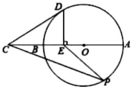

# Mathematics - 题目 3314

**ID**: 96dcf26ebc9a42739dae43f1019ef289
**年级**: Grade 9
**难度**: Medium
**题型**: Calculation

## 题目
古希腊数学家毕达哥拉斯认为：“一切平面图形中最美的是圆”．请研究如下美丽的圆．如图，线段AB是⊙O的直径，延长AB至点C，使BC＝OB，点E是线段OB的中点，DE⊥AB交⊙O于点D，点P是⊙O上一动点（不与点A，B重合），连接CD，PE，PC．（1）求证：CD是⊙O的切线；​​​​​​​‌（2）小明在研究的过程中发现 $\frac {PE}{PC}$ 是一个确定的值．回答这个确定的值是多少？并对小明发现的结论加以证明．

## 解答

1. 解：（1）如答图，连接OD，DB，∵点E是线段OB的中点，DE⊥AB交⊙O于点D，∴DE垂直平分OB，∴DB＝DO．∵DO＝OB，∴DB＝DO＝OB，∴△ODB是等边三角形，∴∠BDO＝∠DBO＝60°．∵BC＝OB＝BD，且∠DBE为△BDC的外角，∴∠BCD＝∠BDC＝ $\frac {1}{2}$ ∠DBO．∵∠DBO＝60°，∴∠CDB＝30°．∴∠ODC＝∠BDO＋∠BDC＝60°＋30°＝90°，∴OD⊥CD，∴CD是⊙O的切线；
2. 
3. （2）这个确定的值是 $\frac {1}{2}$ ．
4. 证明：如答图，连接OP，∵OP＝OB＝BC＝2OE，∴ $\frac {OE}{OP}$ ＝ $\frac {OP}{OC}$ ＝ $\frac {1}{2}$ ，又∵∠COP＝∠POE，∴△OEP∽△OPC，∴ $\frac {PE}{PC}$ ＝ $\frac {OP}{OC}$ ＝ $\frac {1}{2}$ ．
5. 

## 知识点

**中文**:
  - 切线的性质和判定的综合应用
  - 相似三角形的判定与性质综合

**English**:
  - Tangent Applications
  - Determination and Properties

---
