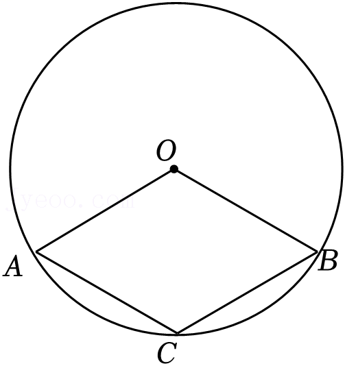

# Mathematics - 题目 2401

**ID**: 9790f04974b74170834ca34fb1aadd11
**年级**: Grade 9
**难度**: Medium
**题型**: 演算步骤或证明过程）.

## 题目
如图，A，B是⊙O上的两点，∠AOB＝120°，点C是 $\overset{\frown}{{AB}}$ 的中点．（1）求证：AC∥OB；​​​​​​​‌（2）延长AO与⊙O交于点D，⊙O的弦BE与AD交于点F（F不与O重合），且EF＝BF，DF＝1，连接AE，求AE长．

## 解答

1. （1）证明：如图，连接OC，
2. ∵点C是 $\overset{\frown}{{AB}}$ 的中点，
3. ∴ $\overset{\frown}{{AC}}=\overset{\frown}{{BC}}$ ，
4. ∵ ${\rm ∠\mathit{AOB}＝120°}$ ，
5. ∴ ${\rm ∠\mathit{AOC}＝∠\mathit{BOC}＝60°}$ ，
6. ∵OA＝OC，
7. ∴ ${\rm △\mathit{AOC}}$ 为等边三角形，
8. ∴ ${\rm ∠\mathit{OCA}＝60°}$ ，
9. ∴ ${\rm ∠\mathit{OCA}＝∠\mathit{BOC}}$ ，
10. ∴AC∥OB；
11. （2）解：∵AD是⊙O的直径，EF＝BF，F不与O重合，
12. ∴AD⊥BE，
13. ∵ ${\rm ∠\mathit{AOB}＝120°}$ ，
14. ∴ ${\rm ∠\mathit{BOF}＝60°}$ ，
15. ∴ ${\rm ∠\mathit{OBF}＝30°}$ ，
16. ∴ ${\rm \mathit{OF}＝}\frac {1}{2}{\rm \mathit{OB}＝}$  $\frac {1}{2}{\rm \mathit{OD}}$ ，
17. ∵DF＝1，
18. ∴OF＝1，OB＝2，
19. ∴ ${\rm \mathit{BF}＝}\sqrt {OB{^{2}}-OF{^{2}}}=\sqrt {3}{\rm ，\mathit{AF}＝\mathit{OA}+\mathit{OF}＝3}$ ，
20. ∴ ${\rm \mathit{EF}＝}\sqrt {3}$ ，
21. ∴ ${\rm \mathit{AE}＝}\sqrt {AF{^{2}}+EF{^{2}}}=\sqrt {3{^{2}}+(\sqrt {3}){^{2}}}=2\sqrt {3}$ ．
22. 

## 知识点

**中文**:
  - 弧、弦、圆心角的关系

**English**:
  - Arcs, Chords, and Central Angles

---
