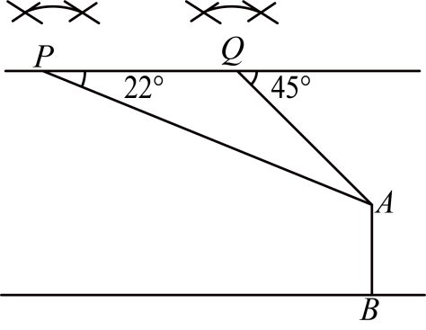

# Mathematics - 题目 181

**ID**: 97e92e1bf12846298e8d7b12dd776f31
**年级**: Grade 9
**难度**: Medium
**题型**: Calculation

## 题目
某数学综合实践小组利用无人机测量建筑物 $AB$ 的高度，已知无人机在距离水平地面 $100{\rm m}$ 空中水平飞行，无人机在 $P$ 、 $Q$ 两点分别测得建筑物顶端 $\mathrm{A}$ 的俯角为 $22{}\degree $ 、 $45{}\degree $ ， $P$ 、 $Q$ 两点的水平距离为 $88$ m．（ $A,B,P,Q$ 在同一平面上）(1)求建筑物 $AB$ 的高度；(2)若建筑物 $AB$ 的左侧 $10{\rm m}$ 处有一建筑物 $MN,MN$ 高为 $50{\rm m}$ ，会不会影响本次测量？请说明理由．（结果精确到1m，参考数据： ${\rm{s}}{\rm{i}}{\rm{n}}22{}\degree \approx 0.​​​​​​​‌4,{\rm{c}}{\rm{o}}{\rm{s}}22{}\degree \approx 0.9,{\rm{t}}{\rm{a}}{\rm{n}}22{}\degree \approx 0.4$ ）．

## 解答

1. （1）解：如图，延长 $BA$ ，交 $PQ$ 的延长线于 $C$ ，则 $\angle ACP=90{}\degree $ ，
2. $\because \angle AQC=45{}\degree $ ，
3. 
4. $\therefore \angle CAQ=45{}\degree $ ，
5. $\therefore AC=CQ$ ，
6. $\because PQ=88{\rm m}$ ，
7. 在 $Rt\vartriangle ACP$ 中，
8. $\therefore {\rm{t}}{\rm{a}}{\rm{n}}22{}\degree =\frac {AC}{PC}$ ，
9. $\therefore AC=88\times 0.4+0.4AC$ ，
10. $\therefore AC\approx 58.7{\rm m}$ ，
11. $\therefore AB=100-58.7=41.3\approx 41{\rm m}$ ．
12. 答：日塔 $AB$ 的高度约为 $41{\rm m}$ ；
13. （2）解：会影响，理由：设建筑物 $MN$ 与 $AP$ 交与点 $M^{′}$ ，
14. 
15. 由题意可知， $BN=10{\rm m}$ ，
16. 过点 $\mathrm{A}$ 作 $AF\bot NM^{′}$ 与点 $F$ ，
17. $\therefore ∠AFM^{′}=90{}\degree $ ，
18. 在 ${\rm{R}}{\rm{t}}\vartriangle AFM^{′}$ 中， $∠AFM^{′}=90{}\degree ，∠PAF=22{}\degree ，AF=BN=10{\rm m}$ ，
19. $\therefore {\rm{t}}{\rm{a}}{\rm{n}}∠PAF=\frac {FM^{′}}{AF}$ ，
20. $\therefore FM^{′}={\rm{t}}{\rm{a}}{\rm{n}}22{}\degree \cdot AF\approx 0.4\times 10=4{\rm m}$ ，
21. $\therefore NM^{′}=NF+FM^{′}=41+4=45{\rm m}$ ，
22. $\because MN=50>45$ ，
23. $\therefore $ 会影响本次测量．

## 知识点

**中文**:
  - 解直角三角形
  - 解直角三角形的实际应用

**English**:
  - Solving Right Triangles
  - Applications of Solving Right Triangles

---
