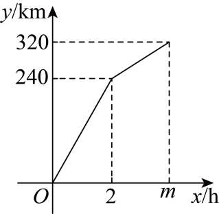

# Mathematics - 题目 2762

**ID**: 9baf6617fed1479caa76caf385f7ba6d
**年级**: Grade 9
**难度**: Medium
**题型**: Calculation

## 题目
$\mathrm{A}$ 、 $B$ 两地之间有一条笔直的公路，甲、乙两车同时从 $\mathrm{A}$ 地出发，匀速去往终点 $B$ 地，一段时间后甲车先到达终点，再过一段时间后，乙车也到达终点．两车行驶的路程之和 $y\left ({{\rm{k}}{\rm{m}}}\right )$ 与乙车行驶的时间 $x\left ({{\rm{h}}}\right )$ 之间的关系如图所示．(1) $\mathrm{A}$ 、 $B$ 两地相距${\rm{k}}{\rm{m}}$ ；​​​​​​​‌(2)求 $m$ 的值；(3)求甲车到达 $B$ 地后 $y$ 与 $x$ 之间的函数解析式．

## 解答

1. （1）∵两人都到终点时，两车行驶的路程之和 $y=320{\rm{k}}{\rm{m}}$ ，
2. ∴ $\mathrm{A}$ 、 $B$ 两地相距为： $\frac {y}{2}=160\left ({{\rm{k}}{\rm{m}}}\right )$ ，
3. 故答案为：160；
4. （2）2小时甲车到达终点时，乙车行驶的路程为：  $240-160=80\left ({{\rm{k}}{\rm{m}}}\right )$ ，
5. 所以乙车的速度为： $80\div 2=40\left ({{\rm{k}}{\rm{m}}/{\rm{h}}}\right )$ ，
6. 所以 $m=2+\frac {320-240}{40}=4$ ．
7. （3）设甲车到达 $B$ 地后 $y$ 与 $x$ 的函数解析式为 $y=kx+b\left ({k\ne 0}\right )$ ．
8. 因为 $y=kx+b\left ({k\ne 0}\right )$ 的图象经过 $\left ({2,240}\right )$ 与 $\left ({4,320}\right )$ ，
9. 所以 $\begin{cases}2k+b=240\\4k+b=320\end{cases}$ ，
10. 解得 $\begin{cases}k=40\\b=160\end{cases}$ ，
11. 所以甲车到达 $B$ 地后 $y$ 与 $x$ 的函数解析式为 $y=40x+160$ ．

## 知识点

**中文**:
  - 从函数的图象获取信息
  - 行程问题
  - 待定系数法求一次函数解析式

**English**:
  - Extracting Information from Graphs
  - Distance-Speed-Time Problems
  - Finding Expressions by Undetermined Coefficients

---
