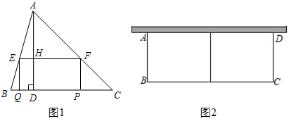

# Mathematics - 题目 1349

**ID**: 9fac0a44652a40d6b957a530e2368f30
**年级**: Grade 9
**难度**: Medium
**题型**: Calculation

## 题目
材料：对于一个关于 $x$ 的二次三项式 $ax{^{2}}+bx+c$ （ $a\ne 0$ ），除了可以利用配方法求该多项式的取值范围外，爱思考的小宁同学还想到了利用根的判别式的方法，如下例：例：求 $x{^{2}}+2x+5$ 的最小值；​​​​​​​‌解：令 $x{^{2}}+2x+5=y$$\therefore x{^{2}}+2x+\left ({5-y}\right )=0$$\therefore Δ=4-4\times \left ({5-y}\right )\geqslant 0$$\therefore y\geqslant 4$ ， $\therefore x{^{2}}+2x+5$ 的最小值为 $4$ ．请利用上述方法解决下列问题：题一：如图1，在 $\vartriangle ABC$ 中， $BC=10$ ，高 $AD=8$ ，矩形 $EFPQ$ 的一边 $QP$ 在边上， $E$ 、 $F$ 两点分别在 $AB$ 、 $AC$ 上， $AD$ 交 $EF$ 于点 $H$ ．设 $EQ=x$ ．①用含 $x$ 的代数式表示 $EF$ 的长为；②求矩形 $EFPQ$ 的面积最大值．题二：如图2，有一老板打算利用一些篱笆，一面利用墙，围成中间隔有一道篱笆的长方形花圃．若要围成面积为 $300$ 平方米的花圃，需要用的篱笆最少是多少米？

## 解答

1. （1）∵四边形EFPQ是矩形,
2. ∴EQ=DH=PF，EF∥BC，
3. ∴ ${\rm △\mathit{AEF}∽△\mathit{ABC}}$ ，
4. ∴ $\frac {AH}{AD}=\frac {EF}{BC}$ ，
5. ∴ $\frac {8-x}{8}=\frac {EF}{10}$ ，
6. ∴ $EF=10-\frac {5}{4}x$ .
7. （2）∵四边形EFPQ是矩形,
8. ∴EQ=DH=PF，EF∥BC，
9. ∴ ${\rm △\mathit{AEF}∽△\mathit{ABC}}$ ，
10. ∴ $\frac {AH}{AD}=\frac {EF}{BC}$ ，
11. ∴ $\frac {8-x}{8}=\frac {EF}{10}$ ，
12. ∴ $EF=10-\frac {5}{4}x$ ，
13. $\therefore S=EF\cdot EQ=x\left ({10-\frac {5}{4}x}\right )=-\frac {5}{4}x{^{2}}+10x$ ，
14. $\therefore \frac {5}{4}x{^{2}}-10x+S=0$ ，
15. $\therefore \Delta =100-5S\geqslant 0$ ，
16. $\therefore S\leqslant 20$ ，
17. $\therefore S{{}_{矩形EFPQ}}$ 有最大值，最大值为 $20$ ．
18. 题二：设 $AD$ 的长为 $x$ 米，则 $AB=\frac {300}{x}$ 米，需要用的篱笆长为 $l$ 米，
19. $\therefore l=3x+\frac {300}{x}$ ，
20. 整理，得 $3x{^{2}}-lx+300=0$ ，
21. $\therefore Δ=l{^{2}}-3600=\left ({l+60}\right )\left ({l-60}\right )\geqslant 0$ ，
22. $\because l+60>0$ ，
23. ∴ $l-60\geqslant 0$
24. $\therefore l\geqslant 60$ ，
25. $\therefore $ 需要用的篱笆最少是 $60$ 米．

## 知识点

**中文**:
  - 一元二次方程根的判别式
  - 相似三角形的判定与性质综合

**English**:
  - Discriminant of Quadratic Equations
  - Determination and Properties

---
