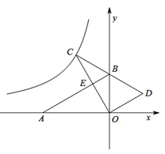

# Mathematics - 题目 2316

**ID**: a088ee4cf821420589ecebb82189d372
**年级**: Grade 9
**难度**: Medium
**题型**: Calculation

## 题目
在平面直角坐标系中，将 $Rt\vartriangle AOB$ 如图放置， $O$ 为原点， $OA$ 在 $x$ 轴负半轴上， $OB=2$ ， $OA=2\sqrt {3}$ ，把 $\vartriangle AOB$ 绕点 $O$ 逆时针旋转得到 $\mathrm{△}COD$ ，使点 $B$ 在线段 $CD$ 上，反比例函数 $y=\frac {k}{x}\left ({x<0}\right )$ 的图象经过点 $C$ ．（1）求 $k$ 的值；​​​​​​​‌（2）过点 $C$ 平行于 $AB$ 的直线与反比例函数 $y=\frac {k}{x}\left ({x<0}\right )$ 的图象相交于点 $M$ ，求点 $M$ 的坐标．

## 解答

1. 解：过点 $C$ 作 $CF$ 垂直 $x$ 轴，垂足为点 $F$ ，
2. ∵ $\angle AOB=90{}^\circ $ ， $AO=2\sqrt {3}$ ， $BO=2$ ，
3. ∴ $\angle ABO=60{}^\circ $ ，
4. ∵ $OB=OD$ ，
5. ∴ $\angle BOD=\angle COA=60{}^\circ $ ，
6. ∵ $OC=OA=2\sqrt {3}$ ，
7. ∴ $OF=\sqrt {3}$ ， $CF=3$ ，
8. ∴点 $C$ 坐标为 $\left ({-\sqrt {3},3}\right )$ ，
9. ∴ $k=-3\sqrt {3}$ ．
10. 
11. （2）解：设直线 $AB$ 解析式为 $y=kx+b$ ，过点 $\left ({0,2}\right )$ ， $\left ({-2\sqrt {3},0}\right )$ ，
12. ∴ $k=\frac {\sqrt {3}}{3}$ ， $b=2$ ，
13. ∵ $AB//CM$ ，
14. ∴直线 $CM$ ： $y=\frac {\sqrt {3}}{3}x+b{{}_{1}}$ 过点 $C\left ({-\sqrt {3},3}\right )$ ，
15. ∴ $b{{}_{1}}=4$ ，
16. 联立方程组 $\begin{cases}y=\frac {\sqrt {3}}{3}x+4\\y=-\frac {3\sqrt {3}}{x}\end{cases}$ ，
17. ∴ $x{{}_{1}}=-\sqrt {3}$ （舍）， $x{{}_{2}}=-3\sqrt {3}$ ，
18. ∴ $M$ 点坐标为 $\left ({-3\sqrt {3},1}\right )$ ．

## 知识点

**中文**:
  - 反比例函数综合
  - 旋转的性质

**English**:
  - Comprehensive Inverse Proportionality Problems
  - Properties of Rotation

---
