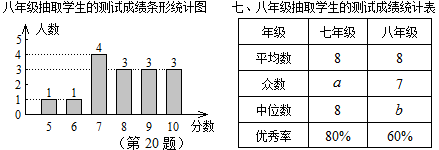

# Mathematics - 题目 3181

**ID**: a1b14892087744a6bfeeb4de89471abb
**年级**: Grade 9
**难度**: Medium
**题型**: Calculation

## 题目
某校七、八年级各有500名学生，为了解该校七、八年级学生对党史知识的掌握情况，从七、八年级学生中各随机抽取15人进行党史知识测试，统计这部分学生的测试成绩（成绩均为整数，满分10分，8分及以上为优秀），相关数据统计、整理如下：七年级抽取学生的成绩：6，6，6，8，8，8，8，8，8，8，9，9，9，9，10；​​​​​​​‌（1）填空： $a$ ＝， $b$ ＝；（2）根据以上数据，你认为该校七、八年级中，哪个年级的学生党史知识掌握得较好？请说明理由（写出一条即可）；（3）请估计七、八年级学生对党史知识掌握能够达到优秀的总人数；（4）现从七、八年级获得10分的4名学生中随机抽取2人参加市党史知识竞赛，请用列表或画树状图法，求出被选中的2人恰好是七、八年级各1人的概率．

## 解答

1. 解：（1）由题意可知： $a$ ＝8，  $b$ ＝8；
2. （2）七年级学生的党史知识掌握得较好，理由如下：
3. ∵七年级和八年级的平均数相同，但是七年级的优秀率大于八年级的优秀率
4. ∴七年级学生的党史知识掌握得较好；
5. （3）从现有样本估计全年级，七年级达到优秀的人数可能有500人×80%＝400人，
6. 八年级达到优秀的人数可能有500人×60%＝300人，
7. 所以两个年级能达优秀的总人数可能会有700人；
8. （4）把七年级的学生记做A，八年级的三名学生即为B、C、D，列表如下：
9. A
10. B
11. C
12. D
13. A
14. （A，B）
15. （A，C）
16. （A，D）
17. B
18. （B，A）
19. （B，C）
20. （B，D）
21. C
22. （C，A）
23. （C，B）
24. （C，D）
25. D
26. （D，A）
27. （D，B）
28. （D，C）
29. 由表知，一共有12种等可能性的结果，恰好每个年级都有一个的结果数是6，
30. 两人中恰好是七八年级各1人的概率是 $\frac {1}{2}$  ．

## 知识点

**中文**:
  - 从统计图分析数据的集中趋势
  - 用样本估计总体
  - 条形统计图
  - 列表法或树状图法求概率

**English**:
  - Analyzing Central Tendency from Charts
  - Estimating Population from Sample
  - Bar Charts
  - Table or Tree Diagram Method

---
