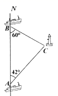

# Mathematics - 题目 3058

**ID**: a2093f01e92d4a1496e21f108d4ad364
**年级**: Grade 9
**难度**: Medium
**题型**: Calculation

## 题目
一轮船以15海里/时的速度向正北方向航行，在A处测得灯塔C在北偏东42°方向，航行2小时到达B处，测得灯塔C在南偏东60°方向，求B处与灯塔C的距离BC的长度（结果保留1位小数）.​​​​​​​‌参考数据： ${\sin}42^\circ =0.67,{\cos}42^\circ =0.74,{\tan}42^\circ =0.90,\sqrt {3}=1.73$

## 解答

1. 解：根据题意，有 $\angle BAC=42^\circ ,\quad \angle ABC=60^\circ $
2. $AB=15\times 2=30$
3. 过C作 $CH\bot ABN$ ，垂足为H
4. 
5. 设 $BH=x$ .
6. 在 ${\rm{R}}{\rm{t}}\Delta BCH$ 中， $\angle CBH=60^\circ $ ，
7. ${\cos}\angle CBH=\frac {BH}{BC},{\tan}\angle CBH=\frac {CH}{BH}$
8. 即 ${\cos}60^\circ =\frac {x}{BC}=\frac {1}{2},{\tan}60^\circ =\frac {CH}{x}=\sqrt {3}$
9. $\therefore BC=2x,\quad CH=\sqrt {3}x$
10. 在 $Rt\Delta ACH$ 中， $\angle CAH=42^\circ $ ，
11. ${\tan}\angle CAH=\frac {CH}{AH}$ ，即 ${\tan}42^\circ =\frac {\sqrt {3}{\rm{x}}}{30-x}$ ．
12. $\therefore \quad x=\frac {30{\tan}42^\circ }{\sqrt {3}+{\tan}42^\circ }\approx \frac {30\times 0.90}{1.73+0.90}\approx 10.27$
13. $\therefore \quad BC=2x\approx 20.5$
14. 答：B处与灯塔C的距离BC的长度约为20.5海里

## 知识点

**中文**:
  - 解直角三角形的实际应用

**English**:
  - Applications of Solving Right Triangles

---
