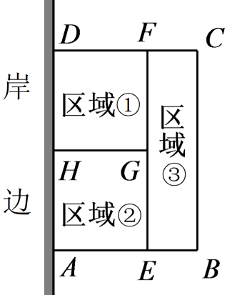

# Mathematics - 题目 2334

**ID**: a35f593282d94fd2af07567a7f538fad
**年级**: Grade 9
**难度**: Medium
**题型**: Calculation

## 题目
为了节省材料，某水产养殖户利用水库的岸堤（岸堤足够长）为一边，用总长为 $160{\rm{m}}$ 的围网在水库中围成了如图所示的 $①②③$ 三块矩形区域，而且这三块矩形区域的面积相等,设 $BC$ 的长度为 $x{\rm{m}}$ ，矩形区域 $ABCD$ 的面积为 $y{\rm{m}}{^{2}}$ .​​​​​​​‌(1)是否存在 $x$ 的值，使得矩形 $ABCD$ 的面积是 $1500{\rm{m}}{^{2}}$ ；(2) $x$ 为何值时， $y$ 有最大值？最大值是多少？

## 解答

1. （1）解：设 $AE=a$ ，由题意得 $AE\cdot AD=2BE\cdot BC,$
2. ∵ $AD=BC$ ，
3. ∴ $BE=\frac {1}{2}a，AB=\frac {3}{2}a$ ，
4. 由题意可得 $2x+3a+2\times \frac {1}{2}a=160$ ，
5. ∴ $a=40-\frac {1}{2}x$ ，
6. ∴ $y=AB\cdot BC=\frac {3}{2}ax=\frac {3}{2}\left ({40-\frac {1}{2}x}\right )x$ ，
7. ∴ $y=-\frac {3}{4}x{^{2}}+60x\left ({0<x<80}\right )$ ，
8. 令 $y=1500$ ,得 $-\frac {3}{4}x{^{2}}+60x=1500$ ，
9. 化简得 $x{^{2}}-80x+2000=0$ ，
10. ∵ $Δ=80{^{2}}-4\times 2000=6400-8000<0$ ，
11. ∴方程无解，
12. 答：不存在 $x$ 的值，使得矩形 $ABCD$ 的面积是 $1500{\rm{m}}{^{2}}$ ．
13. （2） $y=-\frac {3}{4}x{^{2}}+60x=-\frac {3}{4}{\left({x-40}\right)^{2}}+1200$ ，
14. ∴当 $x=40$ 时， $y$ 有最大值，最大值是 $1200{\rm{m}}{^{2}}$ ．

## 知识点

**中文**:
  - 几何问题
  - 图形问题

**English**:
  - Geometry Problems
  - Geometric Problems

---
