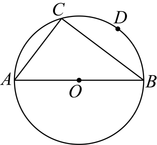

# Mathematics - 题目 1988

**ID**: a6437aa00a4d49b0a32bf5e0aeea0bf9
**年级**: Grade 9
**难度**: Medium
**题型**: Calculation

## 题目
如图， $AB$ 为 $\odot O$ 的直径， $C$ 是圆上一点， $D$ 是 $BC$ 的中点．(1)尺规作图：过点 $D$ 作 $AB$ 的垂线，交半圆 $AB$ 于点 $E$ ，交线段直径 $AB$ 于点 $F$ （保留作图痕迹，不写做法）；​​​​​​​‌(2)点 $P$ 是弧 $AE$ 上一点，连接 $BP,CP,AC=6,BF=2$ ．①求 ${\rm{t}}{\rm{a}}{\rm{n}}\angle BPC$ 的值；②若 $CP$ 为 $∠ACB$ 的角平分线，求 $CP$ 的长．

## 解答

1. （1）解：如图，在半圆 $AB$ 上取点 $E$ ，使 $\overset ⌢{{BD}}=\overset ⌢{{BE}}$ ，连接 $DE$ 交 $AB$ 于 $F$ ，
2. 
3. ∴ $DE⊥AB$ ，
4. （2）解：①连接 $OD$ ，
5. 
6. ∵D是 $BC$ 的中点
7. ∴ $CD=BD$ ，
8. ∴ $\angle CAB=\angle DOB$ ，
9. ∵  $AB$ 为 $\odot O$ 的直径，
10. ∴ $\angle ACB=90{}^\circ $ ，
11. ∵  $DE⊥AB$ ，
12. ∴ $\angle DFO=90{}^\circ $ ，
13. ∴ $\vartriangle ACB∽\vartriangle OFD$ ，
14. ∴ $\frac {AC}{AB}=\frac {OF}{OD}$ ，
15. 设 $\odot O$ 的半径为 $r$ ，则 $\frac {6}{2r}=\frac {r-2}{r}$ ，
16. 解得 $r\mathrm{=}5$ ，经检验， $r\mathrm{=}5$ 是方程的解，
17. ∴ $AB=2r=10$ ，
18. ∴ $BC=\sqrt {AB{^{2}}-AC{^{2}}}=\sqrt {10{^{2}}-6{^{2}}}=8$ ，
19. ∴ ${\tan}\angle CAB=\frac {BC}{AC}=\frac {8}{6}=\frac {4}{3}$ ，
20. ∵  $\angle BPC=\angle CAB$ ，
21. ∴ ${\tan}\angle BPC=\frac {4}{3}$ ；
22. ②如图，过点 $B$ 作 $BG\bot CP$ 交 $CP$ 于点 $G$ ，
23. 
24. ∴ $\angle BGC=\angle BGP=90{}^\circ $ ，
25. ∵ $\angle ACB=90{}^\circ $ ， $CP$ 是 $∠ACB$ 的平分线，
26. ∴ $\angle ACP=\angle BCP=45{}^\circ $ ，
27. ∴ $\angle CBG=45{}^\circ $ ，
28. ∴ $CG=BG=BC·{\cos}45{}^\circ =8\times \frac {\sqrt {2}}{2}=4\sqrt {2}$ ，
29. ∴ ${\tan}\angle BPC=\frac {4}{3}$ ，
30. ∴ $\frac {BG}{GP}=\frac {4}{3}$ ，
31. ∴ $GP=\frac {3}{4}BG=\frac {3}{4}\times 4\sqrt {2}=3\sqrt {2}$ ，
32. ∴ $CP=CG+GP=4\sqrt {2}+3\sqrt {2}=7\sqrt {2}$ ．

## 知识点

**中文**:
  - 垂径定理及其推论
  - 相似三角形的判定与性质综合
  - 解直角三角形

**English**:
  - Perpendicular Chord Theorem
  - Determination and Properties
  - Solving Right Triangles

---
