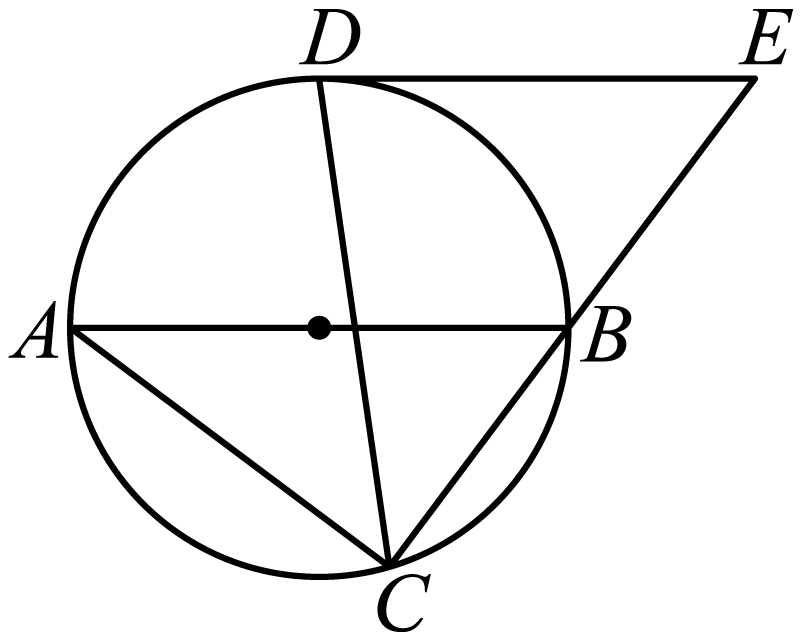

# Mathematics - 题目 3106

**ID**: ad689326fc4947db9c13e7d17fb7e787
**年级**: Grade 9
**难度**: Medium
**题型**: Calculation

## 题目
如图， $AB$ 是 $\odot O$ 的直径，C是 $\odot O$ 上一点， $∠ACB$ 的平分线交 $\odot O$ 于点D，过点D作 $\odot O$ 的切线交CB的延长线于点E．(1)求证： $DE\textit{∥}AB$ ；​​​​​​​‌(2)若 $OA=5$ ， ${\sin}A=\frac {3}{5}$ ，求线段 $DE$ 的长．

## 解答

1. （1）证明： 连接 $OD$ ，如图1．
2. ∵ $DE$ 是 $\odot O$ 的切线，切点是D，
3. ∴ $OD⊥DE$ ．
4. ∴ $\angle ODE=90{}^\circ $ ．
5. ∵ $AB$ 是 $\odot O$ 的直径，
6. ∴ $\angle ACB{\rm{=}}90{}^\circ $ ．
7. ∵ $∠ACB$ 的平分线交 $\odot O$ 于点D，
8. ∴ $\angle ACD=\angle BCD=45{}^\circ $ ．
9. ∴ $\angle AOD=90{}^\circ $ ．
10. ∴ $\angle AOD=\angle ODE$ ．
11. ∴ $DE\textit{∥}AB$ ．
12. 
13. （2）解：作 $BH\bot DE$ 于H，如图2．
14. ∴ $\angle BHD=\angle BHE=90{}^\circ $ ．
15. ∵ $OD\bot DE$ ， $\angle AOD=90{}^\circ $ ，
16. ∴ $\angle BOD=\angle ODH=90{}^\circ $ ．
17. ∴ 四边形 $OBHD$ 是矩形．
18. ∵ $OA=OB=OD=5$ ，
19. ∴ 四边形 $OBHD$ 是正方形．
20. ∴ $BH=OD=DH=5$ ．
21. ∵ 在 ${\rm{R}}{\rm{t}}△ABC$ 中， ${\rm{s}}{\rm{i}}{\rm{n}}A=\frac {3}{5}$ ，
22. ∴ ${\rm{t}}{\rm{a}}{\rm{n}}A=\frac {3}{4}$ ．
23. ∵ $\angle ACB=90{}^\circ $ ，
24. ∴ $\angle A+\angle ABC=90{}^\circ $ ．
25. ∵ $\angle EBH+\angle ABC=90{}^\circ $ ，
26. ∴ $\angle A=\angle EBH$ ．
27. ∴ ${\rm{t}}{\rm{a}}{\rm{n}}\angle EBH={\rm{t}}{\rm{a}}{\rm{n}}A=\frac {3}{4}$ ．
28. ∴ $HE{\rm{=}}BH⋅{\rm{t}}{\rm{a}}{\rm{n}}\angle EBH{\rm{=}}5\times \frac {3}{4}=\frac {15}{4}$ ．
29. ∴ $DE=HE+DH=\frac {35}{4}$ ．
30. 

## 知识点

**中文**:
  - 切线的性质定理
  - 圆周角定理及推论
  - 解直角三角形

**English**:
  - Tangent Properties Theorem
  - Inscribed Angle Theorem
  - Solving Right Triangles

---
