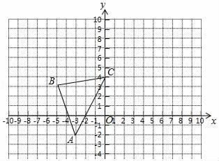

# Mathematics - 题目 3545

**ID**: ae0ba4aa3ee84f05ac716d13be1eb011
**年级**: Grade 9
**难度**: Medium
**题型**: Calculation

## 题目
如图，在平面直角坐标系中，△ABC的顶点为A（﹣3，﹣2），B（﹣5，3），C（0，4）．（1）以C为旋转中心，将△ABC绕C逆时针旋转90°，画出旋转后的对应的△A_{1}B_{1}C_{1}，写出点A_{1}的坐标；​​​​​​​‌（2）求出（1）中点B旋转到点B_{1}所经过的路径长（结果保留根号和π）．

## 解答

1. 解：（1）如图：
2. 
3. ∴点A_{1}的坐标（6，1）
4. （2）点B旋转到点B_{1}所经过的路径长= $\frac {π\times BC\times 90{}^\circ }{180{}^\circ }$ = $\frac {\sqrt {26}π}{2}$ .

## 知识点

**中文**:
  - 弧长公式
  - 旋转的性质

**English**:
  - Arc Length Formula
  - Properties of Rotation

---
