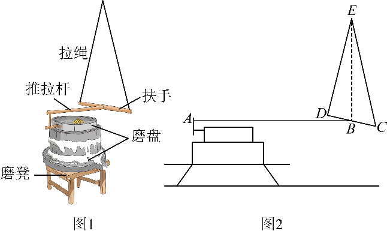

# Mathematics - 题目 2943

**ID**: aed1a1e4676b4fdd8fe24917c492bf0d
**年级**: Grade 9
**难度**: Medium
**题型**: 解答题(共9题，75分)

## 题目
“腊月二十五，推磨做豆腐”．嵊州市某新农村至今还保留着过除夕前磨豆腐的传统习俗．如图1是磨豆腐用的传统工具老石磨，主要部件为一条磨凳，上下两个磨盘，一根推拉杆以及用拉绳稳定的推拉用的扶手等．图2是老石磨静止时的示意图，推拉杆 $AB$ 及扶手 $CD$ 平行于水平面，E是天花板顶部的拉钩，两根拉绳与扶手 $CD$ 恰好组成等腰三角形 $CDE$ ，此时拉钩E与扶手 $CD$ 的中心点B所在的直线垂直于水平面．现测得推拉杆 $AB$ 距地面的高度为 $1.​​​​​​​‌2\text{m}$ ，天花板顶部E距地面 $3.1\text{m}$ ，若 $\angle BCE=80°$ ，求两根拉绳的总长度至少为多少m．(结果精确到 $0.01\text{m}$ ．参考数据： $\sin 80°\approx 0.98$ ， $\cos 80°\approx 0.17$ ， $\tan 80°\approx 5.67$ )

## 解答

1. 解：由题意，可得 $EB=3.1-1.2=1.9\left ({{\rm{m}}}\right )$ ，
2. ∵ $ED=EC{\rm ，\mathit{B}}$ 为 $CD$ 的中点，
3. ∴ $EB\bot CD$ ，
4. ∴ $\angle EBC=90{}\degree $ ，
5. 在 ${\rm{R}}{\rm{t}}\vartriangle EBC$ 中，∵ $\sin \angle BCE=\frac {EB}{EC}\approx 0.98$ ， $EB=1.9{\rm{m}}$ ，
6. ∴ $EC=\frac {EB}{0.98}=\frac {1.9}{0.98}\left ({{\rm{m}}}\right )$ ，
7. ∴ $2EC=2\times \frac {1.9}{0.98}\approx 3.88\left ({{\rm{m}}}\right )$
8. 答：两根拉绳的总长度至少为 $3.88{\rm{m}}$ ．

## 知识点

**中文**:
  - 解直角三角形的实际应用

**English**:
  - Applications of Solving Right Triangles

---
