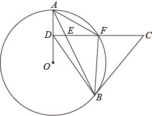

# Mathematics - 题目 3253

**ID**: b08409ac95404c55802876c7c6bf789d
**年级**: Grade 9
**难度**: Medium
**题型**: Calculation

## 题目
图，AB是 $\odot O$ 的弦，D为半径OA的中点，过点D作 $CD\bot OA$ 交弦AB于点E，交 $\odot O$ 于点F，且CE＝CB，连接AF，BF．(1)求证：BC是 $\odot O$ 的切线；​​​​​​​‌(2)求∠ABF的度数；(3)如果BE＝4， ${\sin}\angle OAB=\frac {1}{2}$ ，求 $\odot O$ 的半径．

## 解答

1. (1)
2. 明：连接OB，如图，
3. 
4. ∵OB＝OA，CE＝CB，
5. ∴∠OAB＝∠OBA，∠CEB＝∠ABC，
6. ∵CD⊥OA，
7. ∴∠OAB＋∠AED＝90°，
8. ∵∠AED＝∠CEB＝∠ABC，
9. ∴∠OBA＋∠ABC＝90°，
10. ∴∠OBC=90°，
11. ∴BC是⊙O的切线；
12. (2)
13. ：连接OF，如图，
14. 
15. ∵DA＝DO，CD⊥OA，∴FA＝FO，
16. ∵OA＝OF，∴△OAF是等边三角形，
17. ∴∠AOF＝60°，∴ $\angle ABF=\frac {1}{2}\angle AOF=30{}^\circ $ ；
18. (3)
19. ：如图，过O作OH⊥AB于H，
20. 
21. ∵sin∠OAB= $\frac {1}{2}$ ，∴∠OAB=30°，
22. 设圆的半径为r，则AD= $\frac {1}{2}$r，
23. Rt△ADE中，AE= $\frac {AD}{{\cos}\angle DAE}$ = $\frac {\sqrt {3}r}{3}$ ，
24. Rt△AOH中，AH=AOcos∠OAH= $\frac {\sqrt {3}r}{2}$ ，
25. OH⊥AB，则AH= $\frac {1}{2}$AB= $\frac {1}{2}$ （AE+BE）= $\frac {1}{2}$ （ $\frac {\sqrt {3}r}{3}$ +4），
26. ∴ $\frac {\sqrt {3}r}{2}$ = $\frac {1}{2}$ （ $\frac {\sqrt {3}r}{3}$ +4），解得：r= $2\sqrt {3}$ ，
27. ∴ $\odot O$ 的半径为： $2\sqrt {3}$ ；

## 知识点

**中文**:
  - 切线的判定定理
  - 等腰三角形的性质
  - 垂径定理的应用
  - 圆周角定理及推论
  - 解直角三角形

**English**:
  - Tangent Determination Theorem
  - Properties of Isosceles Triangles
  - Applications of Perpendicular Chord Theorem
  - Inscribed Angle Theorem
  - Solving Right Triangles

---
