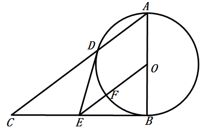

# Mathematics - 题目 2175

**ID**: b0af0f3f4ad24a0daadfb080dd56c594
**年级**: Grade 9
**难度**: Medium
**题型**: Calculation

## 题目
如图， $\vartriangle ABC$ 是直角三角形， $\angle ABC=90{}^\circ $ ，以 $AB$ 为直径的 $\odot O$ 与边 $AC$ 交于点 $D$ ，过 $D$ 作 $\odot O$ 的切线 $DE$ 交 $BC$ 于 $E$ ，连接 $OE$ ，交 $\odot O$ 于 $F$ ．（1）求证： $OE{\rm{/}}{\rm{/}}AC$ ；​​​​​​​‌（2）若 $AB=6$ ， $AD=\frac {18}{5}$ ，求线段 $EF$ 的长．

## 解答

1. 证明（1）方法一：连接 $BD$ 交 $EO$ 于 $G$ ，
2. ∵ $\angle ABC=90{}^\circ $ 且 $AB$ 为 $\odot O$ 直径
3. ∴ $BC$ 是 $\odot O$ 的切线
4. 又∵DE是 $\odot O$ 的切线
5. ∴ $BE=DE$ ， $\angle DEO=\angle BEO$ ，
6. ∴ $EO\bot BD$
7. ∴ $\angle OGB=90{}^\circ $
8. ∵ $AB$ 为 $\odot O$ 直径
9. ∴ $\angle ADB=90{}^\circ $
10. ∴ $OE{\rm{/}}{\rm{/}}AC$
11. 
12. 方法二：连接 $BD$ ，
13. ∵ $\angle ABC=90{}^\circ $ 且 $AB$ 为 $\odot O$ 直径
14. ∴ $BC$ 是 $\odot O$ 的切线
15. 又∵ $DE$ 是 $\odot O$ 的切线
16. ∴ $BE=DE$
17. ∴ $\angle 1=\angle 2$
18. ∵ $AB$ 为 $\odot O$ 直径
19. ∴ $\angle ADB=90{}^\circ $
20. ∴ $\angle CDB=180{}^\circ -90{}^\circ =90{}^\circ $
21. ∴ $\angle 1+\angle 3=\angle 2+\angle 4=90{}^\circ $
22. ∴ $\angle 3=\angle 4$
23. ∴ $CE=DE$
24. ∴ $BE=CE$
25. 又∵ $AO=BO$
26. ∴ $OE{\rm{/}}{\rm{/}}AC$
27. （2）连接 $DO$ ，
28. 
29. ∵ $\angle OGB=90{}^\circ $
30. ∴ $\angle 5+\angle 6=90{}^\circ $
31. ∵ $\angle ABC=90{}^\circ $
32. ∴ $\angle 6+\angle BEO=90{}^\circ $
33. ∴ $\angle 5=\angle BEO=\angle DEO$
34. ∵ $\angle ADB=90{}^\circ $
35. 又∵ $AB=6$ ， $AD=\frac {18}{5}$
36. ∴ ${\sin}\angle 5=\frac {AD}{AB}=\frac {3}{5}$
37. ∴ ${\sin}\angle DEO=\frac {DO}{EO}=\frac {3}{5}$
38. ∵ $DO=\frac {1}{2}AB=3$
39. ∴ $EO=5$
40. ∴ $EF=EO-OF=5-3=2$
41. ∴ $EF=2$ ．

## 知识点

**中文**:
  - 切线的判定定理
  - 圆周角定理及推论
  - 切线的性质定理

**English**:
  - Tangent Determination Theorem
  - Inscribed Angle Theorem
  - Tangent Properties Theorem

---
