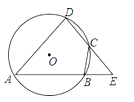

# Mathematics - 题目 3613

**ID**: b6752d35160148c3a290ce641b74b165
**年级**: Grade 9
**难度**: Medium
**题型**: Calculation

## 题目
如图，已知A、B、C、D是⊙O上的四点，延长DC、AB相交于点E．若BC=BE．求证：△ADE是等腰三角形．​​​​​​​‌

## 解答

1. 试题分析：求出 $\angle A=\angle BCE=\angle E，$  即可得出 $AD=DE$ ，从而判定等腰三角形．
2. 试题解析： $\because A、D、C、B$ 四点共圆，
3. $\therefore \angle A=\angle BCE，$
4. $\because BC=BE，$
5. $\therefore \angle BCE=\angle E，$
6. $\therefore \angle A=\angle E，$
7. $\therefore AD=DE，$
8. 即 $\vartriangle ADE$ 是等腰三角形．

## 知识点

**中文**:
  - 圆内接四边形

**English**:
  - Cyclic Quadrilaterals

---
