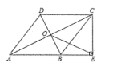

# Mathematics - 题目 1410

**ID**: b70b3ef59a16446ba3ddc74aa59d1761
**年级**: Grade 9
**难度**: Medium
**题型**: Calculation

## 题目
如图，在四边形ABCD中，AB//DC，AB=AD，对角线AC，BD交于点O，AC平分 $\angle BAD$ ，过点C作 $CE\bot AB$ 交AB的延长线于点E，连接OE．（1）求证：四边形ABCD是菱形；​​​​​​​‌（2）若 $AB=2\sqrt {5},BD=4$ ，求OE的长．

## 解答

1. 解：（1）∵AB∥CD，
2. ∴∠OAB＝∠DCA，
3. ∵AC 为∠DAB 的平分线，
4. ∴∠OAB＝∠DAC，
5. ∴∠DCA＝∠DAC，
6. ∴CD＝AD
7. $\because AB=AD,$
8. $\therefore AB=CD,$
9. ∵AB∥CD，
10. ∴四边形 ABCD 是平行四边形，
11. ∵AD＝AB，
12. ∴ $▱ABCD$ 是菱形；
13. （2）∵四边形 ABCD 是菱形，
14. ∴OA＝OC， $OB=OD,$  BD⊥AC，
15. ∵CE⊥AB，
16. ∴OE＝OA＝OC，
17. ∵BD＝4，
18. ∴OB＝ $\frac {1}{2}$  BD＝2，
19. 在 $Rt\vartriangle AOB$ 中，AB＝2 $\sqrt {5}$  ，OB＝2，
20. ∴ $OA=\sqrt {{\left({2\sqrt {5}}\right)^{2}}-2{^{2}}}=4,$
21. ∴OE＝OA＝4．

## 知识点

**中文**:
  - 一组对边平行且相等的四边形是平行四边形
  - 菱形的判定

**English**:
  - One Pair of Parallel and Equal Opposite Sides
  - Determination of Rhombuses

---
