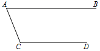

# Mathematics - 题目 2114

**ID**: b735f5952fe04741b5e4016107dfdd90
**年级**: Grade 9
**难度**: Medium
**题型**: Calculation

## 题目
如图，AB，CD为两条射线，AB∥CD，连接AC．（1）尺规作图：在CD上找一点E，使得AE平分∠BAC，交CD于点E．(不写作法，保留作图痕迹)．（2）在题（1）所作的图形中，若∠C＝120°，求∠CEA的度数．​​​​​​​‌

## 解答

1. 解：（1）如图，射线AE即为所求．
2. 
3. （2）∵AB∥CD，
4. ∴∠C+∠CAB＝180°，
5. ∵∠C＝120°，
6. ∴∠CAB＝60°，
7. ∵AE平分∠CAB，
8. ∴∠BAE＝ $\frac {1}{2}$ ∠CAB＝30°，
9. ∴∠AEC＝∠BAE＝30°．

## 知识点

**中文**:
  - 两直线平行同旁内角互补
  - 角平分线
  - 角平分线的性质
  - 尺规作图——作角平分线

**English**:
  - Parallel Lines have Supplementary Consecutive Angles
  - Angle Bisector
  - Properties of Angle Bisectors
  - Construction: Angle Bisector

---
