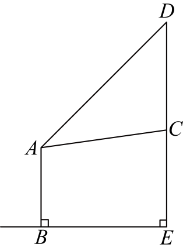

# Mathematics - 题目 485

**ID**: bb54cf46fd2740cfacc17c7d35fd60a5
**年级**: Grade 9
**难度**: Medium
**题型**: Calculation

## 题目
智能测量是一款非常有创意且使用性很高的手机测距软件，它可以利用手机上的摄像头和距离传感器来测量目标的距离、高度、宽度、角度和面积，测量过程非常简单、要测量一座雕像的高度，打开手机软件后将手机摄像头的屏幕准星对准雕像底部按键，再对准顶部按键即可测量出雕像的高度，其数学原理如图所示，测量者 $AB$ 与雕像 $CD$ 垂直于地面 $BE$ ，若手机显示 $AC=5{\rm{m}}$ ， $AD=7{\rm{m}}$ ， $\angle CAD=37{}^\circ $ ．(1)求雕像 $CD$ 的高度．(2)求测量者离雕像底部的距离 $BE$ 的长．（结果保留两位小数，参考数据： ${\sin}37{}^\circ \approx 0.​​​​​​​‌60$ ， ${\cos}37{}^\circ \approx 0.80$ ， ${\tan}37{}^\circ \approx 0.75$ ， $\sqrt {2}\approx 1.414$ ）

## 解答

1. （1）解：如图，过点C作 $CF\bot AD$ 于点F．
2. 在 ${\rm{R}}{\rm{t}}\vartriangle ACF$ 中， ${\rm{s}}{\rm{i}}{\rm{n}}∠CAF=\frac {CF}{AC}$ ，
3. $\therefore CF=5\cdot {\rm{s}}{\rm{i}}{\rm{n}}37{}^\circ \approx 3\left ({{\rm{m}}}\right )$ ，
4. $\therefore AF=\sqrt {AC{^{2}}-CF{^{2}}}=\sqrt {5{^{2}}-3{^{2}}}=4\left ({{\rm{m}}}\right )$ ，
5. $\therefore DF=AD-AF=3{\rm{m}}$ ．
6. 在 ${\rm{R}}{\rm{t}}\vartriangle CFD$ 中， $CD=\sqrt {3{^{2}}+3{^{2}}}=3\sqrt {2}\approx 4.24\left ({{\rm{m}}}\right )$ ．
7. 答：雕像 $CD$ 的高度约为 $4.24{\rm{m}}$ ．
8. （2）解：如图，过点A作 $AG\bot DE$ 于点G，则四边形 $ABEG$ 为矩形，
9. $\therefore BE=AG$ ．
10. 在 ${\rm{R}}{\rm{t}}△DFC$ 中，由于 ${\rm{t}}{\rm{a}}{\rm{n}}D=\frac {CF}{DF}=\frac {3}{3}=1\left ({{\rm{m}}}\right )$ ，
11. $\therefore \angle D=45{}^\circ $ ．
12. 在 ${\rm{R}}{\rm{t}}\vartriangle ADG$ 中， ${\rm{s}}{\rm{i}}{\rm{n}}D=\frac {AG}{AD}$ ，
13. $\therefore AG=7\cdot {\rm{s}}{\rm{i}}{\rm{n}}45{}^\circ =\frac {7\sqrt {2}}{2}\approx 4.95\left ({{\rm{m}}}\right )$ ，
14. $\therefore BE\approx 4.95{\rm{m}}$ ．
15. 答：测量者离雕像底部的距离 $BE$ 的长约为 $4.95{\rm{m}}$ ．
16. 

## 知识点

**中文**:
  - 解直角三角形
  - 解直角三角形的实际应用

**English**:
  - Solving Right Triangles
  - Applications of Solving Right Triangles

---
