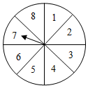

# Mathematics - 题目 601

**ID**: bc8c527d4d564491a41d94cc6b86a26a
**年级**: Grade 9
**难度**: Medium
**题型**: Calculation

## 题目
节假日期间，某超市开展有奖促销，凡在超市购物的顾客均有转动转盘的机会（如图，转盘被分为8个扇形），规定当转盘停下来时指针指向8就中一等奖，指向2或6就中二等奖，指向1或3或5就中三等奖；​​​​​​​‌指向其余数字不中奖．（1）转动转盘中一等奖、二等奖、三等奖的概率分别是多少？（2）顾客中奖的概率是多少？

## 解答

1. 解：（1）由题意可知： $P{{}_{\left ({一等奖}\right )}}=\frac {1}{8}$ ， $P{{}_{\left ({二等奖}\right )}}=\frac {2}{8}=\frac {1}{4}$ ， $P{{}_{\left ({三等奖}\right )}}=\frac {3}{8}$ ；
2. （2）8，2，6，1，3，5份数之和为6，
3. $\therefore $ 转动圆盘中奖的概率为： $\frac {6}{8}=\frac {3}{4}$ ．

## 知识点

**中文**:
  - 简单的概率计算

**English**:
  - Simple Probability Calculations

---
