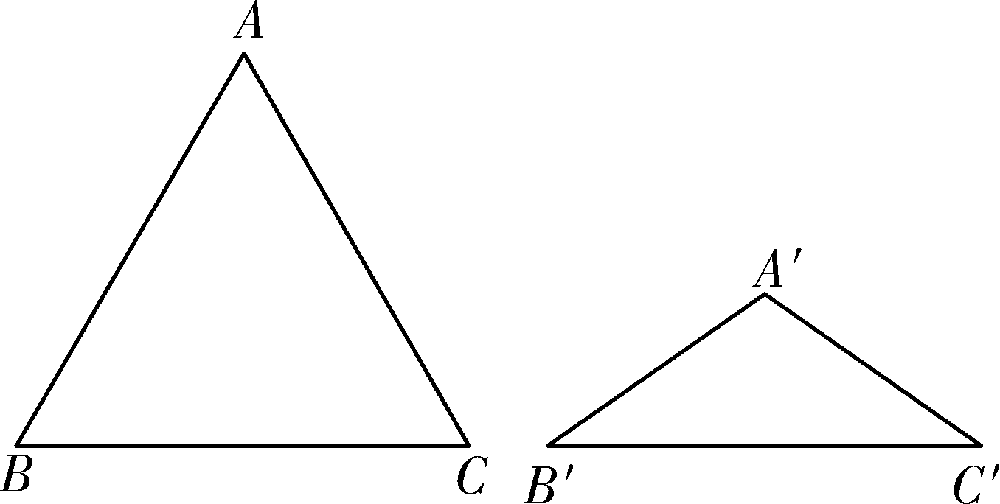

# Mathematics - 题目 2545

**ID**: bf06c0a91aec42229bb9d2b8c55f34fe
**年级**: Grade 9
**难度**: Medium
**题型**: Calculation

## 题目
如图，△ABC与△A′B′C′都是等腰三角形，且AB＝AC＝5，A′B′＝A′C′＝3．若∠B＋∠B′＝90°，求△ABC与△A′B′C′的面积比．​​​​​​​‌

## 解答

1. 解：分别作AD⊥BC于点D，A′D′⊥B′C′于点D′，如图，
2. 则∠ADB＝∠A′D′B′＝90°．
3. 
4. ∴∠B＋∠BAD＝90°．
5. 又∵∠B＋∠B′＝90°，
6. ∴∠BAD＝∠B′．
7. ∴△ABD∽△B′A′D′．
8. ∴S_{△}ABD∶S_{△}B_{′}A_{′}D_{′}＝( $\frac {AB}{A{^{\prime }}B{^{\prime }}}$ )^{2}＝25∶9．
9. ∵AB＝AC，AD⊥BC，
10. ∴S_{△}ABC＝2S_{△}ABD．
11. 同理可得S_{△}A_{′}B_{′}C_{′}＝2S_{△}B_{′}A_{′}D_{′}．
12. ∴S_{△}ABC∶S_{△}A_{′}B_{′}C_{′}＝25∶9．

## 知识点

**中文**:
  - 相似三角形的判定与性质综合

**English**:
  - Determination and Properties

---
