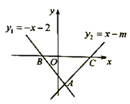

# Mathematics - 题目 1775

**ID**: c147f813282440188a0f2a091f9273bb
**年级**: Grade 9
**难度**: Medium
**题型**: Calculation

## 题目
如图，一次函数 $y{{}_{1}}=-x-2$ 与 $y{{}_{2}}=x-m$ 的图象相交于 $A\left ({n,-3}\right )$（1）求点 $\mathrm{A}$ 的坐标及 $m$ ；（2）若一次函数 $y{{}_{1}}=-x-2$ 与 $y{{}_{2}}=x-m$ 的图象与 $x$ 轴分别相交于点 $B$ 、 $C$ ，求 $ΔABC$ 的面积.​​​​​​​‌（3）结合图象，直接写出 $y{{}_{1}}>y{{}_{2}}$ 时 $x$ 的取值范围.

## 解答

1. 解：（1）把 $A\left ({n,-3}\right )$ 代入 $y{{}_{1}}=-x-2$ 中，则 $n=1$
2. ∴ $A\left ({1,-3}\right )$
3. 把 $A\left ({1,-3}\right )$ 代入 $y{{}_{2}}=x-m$ 中，则 $m=4$
4. （2）当 $y{{}_{1}}=0$ 时， $-x-2=0$ ， $x=-2$ ，则 $B$ 点坐标为 $\left ({-2,0}\right )$ ；
5. 当 $y{{}_{2}}=0$ 时， $x-4=0,x=4$ ，则 $C$ 点坐标为 $\left ({4,0}\right )$ ；
6. ∴ $BC=4-\left ({-2}\right )=6$ ，
7. ∴ $ΔABC$ 的面积 $=\frac {1}{2}\times 6\times 3=9$ ；
8. （3）根据图象可知， $y{{}_{1}}>y{{}_{2}}$ 时 $x$ 的取值范围是 $x<1$ ．

## 知识点

**中文**:
  - 一次函数与一元一次不等式
  - 一次函数的图象和性质
  - 待定系数法求一次函数解析式

**English**:
  - Linear Functions and Linear Inequalities
  - Graphs and Properties of Linear Functions
  - Finding Expressions by Undetermined Coefficients

---
