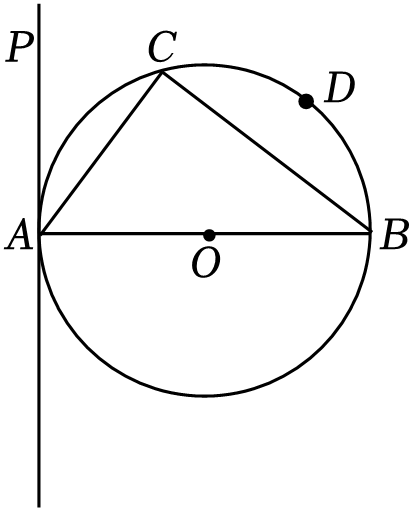

# Mathematics - 题目 2300

**ID**: c1cdfae002984920aaaa30e00d46b2da
**年级**: Grade 9
**难度**: Medium
**题型**: 证明过程或演算步骤）

## 题目
如图， $AB$ 是 $\odot O$ 直径， $C$ 是 $\odot O$ 上一点，过点 $A$ 作直线 $PA$ ，使 $\angle PAC=\angle ABC$ ．（1）求证： $PA$ 是 $\odot O$ 的切线；​​​​​​​‌（2）点 $D$ 是弧 $BC$ 中点，连接 $DO$ 并延长，分别交 $BC$ ， $PA$ 于点 $E$ ， $F$ ，若 $BC=8$ ， ${\cos}\angle PAC=\frac {4}{5}$ ，求线段 $DF$ 的长．

## 解答

1. （1）证明： $\because AB$ 是 $\odot O$ 直径， $\therefore \angle ACB=90{}^\circ $ ， $\therefore \angle BAC+\angle ABC=90{}^\circ $ ， $\because \angle PAC=\angle ABC$ ， $\therefore \angle PAC+\angle BAC=90{}^\circ $ ， $\therefore PA\bot AB$ ， $\therefore PA$ 是 $\odot O$ 的切线；
2. （2）解：由（1）知 $\angle PAC=\angle ABC$ ， $\angle ACB=90{}^\circ $ ， $\because $  ${\cos}\angle PAC=\frac {4}{5}$ ， $\therefore {\cos}\angle ABC=\frac {BC}{AB}=\frac {8}{AB}=\frac {4}{5}$ ， $\therefore AB=10$ ， $\because $ 点 $D$ 是弧 $BC$ 中点， $\therefore $  $\widehat {BD}=\widehat {CD}$ ， $\therefore OD\bot BC$ ， $BE=\frac {1}{2}BC=\frac {1}{2}\times 8=4$ ， $\because PA\bot AB$ ， $OD\bot BC$ ， $\therefore \angle FAO$  $=\angle OEB=90{}^\circ $ ， $\because \angle AOF=\angle BOE$ ， $\therefore ΔAOF∽ΔEOB$ ， $\therefore $  $\frac {AO}{OE}=\frac {OF}{OB}$ ， $\because OE=\sqrt {OB{^{2}}-BE{^{2}}}=\sqrt {5{^{2}}-4{^{2}}}=3$ ， $\therefore $  $\frac {5}{3}=\frac {OF}{5}$ ， $\therefore OF=\frac {25}{3}$ ， $\therefore DF=\frac {25}{3}+5=\frac {40}{3}$ ．

## 知识点

**中文**:
  - 切线的性质和判定的综合应用
  - 勾股定理
  - 相似三角形的判定与性质综合

**English**:
  - Tangent Applications
  - Pythagorean Theorem
  - Determination and Properties

---
