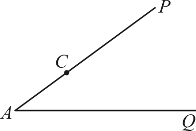

# Mathematics - 题目 3256

**ID**: c1f8bf93d0d14057ba1d50b4a28fe797
**年级**: Grade 9
**难度**: Medium
**题型**: Calculation

## 题目
如图，已知 $\angle PAQ$ 及边 $AP$ 上一点 $C$ ．(1)用无刻度直尺和圆规在射线 $AQ$ 上求作点 $O$ ，使得 $\angle COQ=2\angle CAQ$ （保留作图痕迹，写出必要的文字说明）；​​​​​​​‌(2)在（1）的条件下，以点 $O$ 为圆心， $OA$ 为半径的圆交射线 $AQ$ 于点 $B$ ，用无刻度直尺和圆规在射线 $CP$ 上求作点 $M$ ，使点 $M$ 到点 $C$ 的距离与点 $M$ 到射线 $AQ$ 的距离相等（保留作图痕迹，写出必要的文字说明）；

## 解答

1. （1）解：如图，作 $AC$ 的垂直平分线交 $AB$ 于 $O$ ，
2. 由垂直平分线的性质可知， $OC=OA$ ，
3. $\therefore \angle CAQ=\angle OCA$ ，
4. $\therefore \angle COQ=\angle CAQ+\angle OCA=2\angle CAQ$ ，
5. $\therefore \angle COQ=2\angle CAQ$ ，
6. ∴点 $O$ 即为所作；
7. 
8. （2）解：如图，作 $\angle CBQ$ 的角平分线交 $AP$ 于 $M$ ，
9. 则 $\angle CBM=\angle MBQ$ ，
10. $\because OA=OC=OB$ ，
11. $\therefore \angle OCB=\angle OBC$ ，
12. 又 ∵ $\angle CAQ+\angle OCA+\angle OCB+\angle OBC=180{}\degree $ ，
13. $\therefore \angle ACB=\angle OCA+\angle OCB=90{}\degree $ ，即 $CM\bot BC$ ，
14. 如图，作 $MH\bot BQ$ 于 $H$ ，
15. ∴ $\angle MHB=\angle MCB=90{}\degree $ ，
16. $\therefore MH=CM$ ，
17. ∴点 $M$ 即为所作．

## 知识点

**中文**:
  - 尺规作图——作线段垂直平分线
  - 角平分线的性质
  - 尺规作图——作角平分线
  - 线段垂直平分线的性质

**English**:
  - Construction: Perpendicular Bisector
  - Properties of Angle Bisectors
  - Construction: Angle Bisector
  - Properties of Perpendicular Bisectors

---
